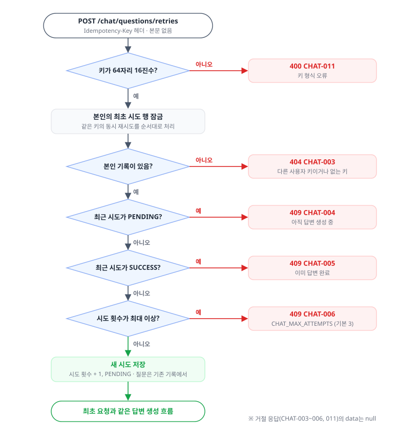

# 코드 구조와 요청 흐름

> 문서 기준: UBot-BE `develop` [`2fdb6ec`](https://github.com/ureca-UBot/UBot-BE/commit/2fdb6ec145d6092696651d83e4b6ff01ffb821c0) (2026-09-29 19:55 KST 커밋, #105 병합 시점) · 작성일 2026-09-30
>
> GitHub PR·이슈 상태: 2026-09-30 09:23 KST 조회 기준

## 패키지 구조

```text
com.ubot
├── auth           인증 (JWT 발급·검증, refresh token, Security 설정)
├── user           사용자 엔티티·저장소·서비스, 내 정보 조회·수정 (/auth/me)
├── chat           질문 접수 (컨트롤러 → ChatService → chat.job), 답변 Worker (ChatJobWorker → ChatJobProcessor → ChatAnswerProcessor), 답변 시도 기록·재시도
├── ai             FAQ 프롬프트 구성과 LLM 호출 연결 (AiService)
├── prompt         질문·FAQ를 프롬프트 템플릿에 반영 (PromptService)
├── llm            LLM 요청 검증·Ollama 호출·오류 변환
├── embedding      임베딩 서버 호출(EmbeddingService → EmbeddingClient)과 Embedding Profile 조회
├── faq            FAQ·카테고리 CRUD, 수정 이력(old_faq)·참고 로그(faq_log), FAQ 벡터 검색
├── forbiddenword  금지어 관리 API, 채팅 입력 금지어 필터 (메모리 캐시)
├── unanswered     답을 찾지 못한 질문 저장과 유사 질문 묶기
├── location       카카오 로컬 API 연동 (주소·좌표 검색)
├── store          매장 조회 (목록·상세·근처·지도·클러스터, PostGIS), 관리자 매장 관리
├── direction      매장 길찾기 (카카오 도보·대중교통, 카카오모빌리티 자동차)
├── global         공통 설정 (프로세스 역할 APP_ROLE: api·worker·all)
└── common         공통 응답·에러코드·전역 예외 처리, OpenAPI 설정
```

| 종류 | 위치 |
|---|---|
| DB 마이그레이션 | `src/main/resources/db/migration/V1`~`V33` |
| 매장 조회 SQL | `src/main/resources/sql/store/*.sql` |
| FAQ 프롬프트 | `src/main/resources/prompts/faq-system.txt`, `faq-user.txt` |
| DB 이미지 | `infra/postgres/Dockerfile` |
| 개발용 컨테이너 | `docker-compose.yml`(공통), `docker-compose.ollama.yml`, `docker-compose.vllm.yml`. `tools/ubot.ps1`이 `AI_MODE`에 맞는 파일을 골라 띄움 ([실행 환경](reference/configuration.md#실행-환경-docker-compose)) |
| 배포용 | `Dockerfile`, `docker-compose.deploy.yml`, `infra/nginx/nginx.conf` ([deploy.md](deploy.md)) |
| GitHub Actions | `.github/workflows/ci.yml`, `commit-message.yml`, `cd-manual.yml` |
| 응답·예외 작성 규칙 | `src/main/java/com/ubot/common/manual/*.md` |

## API 개요

모든 응답은 `ApiResponse<T>`(`success`, `code`, `message`, `data`) 형식입니다. 요청·응답 필드는 애플리케이션 실행 후 Swagger UI(`/swagger-ui.html`)에서 확인하세요.

| 영역 | 경로 | 인증 |
|---|---|---|
| 인증 | `POST /auth/signup`, `/auth/login`, `/auth/refresh` | 불필요 |
| 인증 | `POST /auth/logout` | JWT |
| 내 정보 | `GET`, `PATCH /auth/me` | JWT |
| 챗봇 | `POST /chat/questions`, `POST /chat/questions/retries` (`Idempotency-Key` 헤더) → `202`와 `jobId`, `GET /chat/jobs/{jobId}` (상태·답변 조회) | JWT 또는 게스트 세션(`JSESSIONID`) |
| 매장 | `GET /stores`, `/stores/{storeId}`, `/stores/nearby`, `/stores/map`, `/stores/map/clusters`, `/stores/regions/sidos`, `/stores/regions/sigungus` | 불필요 |
| 길찾기 | `GET /stores/{storeId}/directions?mode=WALK\|CAR\|TRANSIT`, `POST /stores/{storeId}/directions/transit-detail` | 불필요 |
| 위치 | `GET /locations/search?query=` | 불필요 |
| 관리자 FAQ | `/admin/faqs`, `/admin/deleted-faqs`, `/admin/faqs/restore`, `/admin/faq-categories/**`, `/admin/faq-logs/**`, `/admin/old-faqs/faq` | JWT + `ADMIN` |
| 임베딩 백필 | `POST /admin/faqs/embeddings/backfill`, `POST /admin/unanswered-groups/embeddings/backfill` (지금 Profile에 없는 벡터 채우기) | JWT + `ADMIN` |
| 관리자 금지어 | `/admin/forbidden-words/**` | JWT + `ADMIN` |
| 관리자 게스트 설정 | `GET`, `PATCH /admin/guest-chat-settings` (게스트 최대 질문 횟수) | JWT + `ADMIN` |
| 관리자 매장 | `/admin/stores/**` (등록·수정·삭제·활성화·목록·삭제 목록) | JWT + `ADMIN` |
| 상태 확인 | `GET /actuator/health` | 불필요 |
| 챗봇 | `POST /chat/questions/research` (`Idempotency-Key` 헤더, 본문 `intent`와 선택적 `latitude`·`longitude`) | JWT (회원 전용) |

## 인증

- 세션을 쓰지 않는 stateless 구조입니다(`SecurityConfig`).
- 인증 없이 호출할 수 있는 경로는 `/auth/login`, `/auth/signup`, `/auth/refresh`, `/stores/**`, `/locations/**`, `/actuator/health`, Swagger(`/v3/api-docs/**`, `/swagger-ui/**`, `/swagger-ui.html`)입니다. `/admin/**`은 `ADMIN` 역할이 필요하고, 나머지는 모두 JWT가 필요합니다.
- `JwtAuthenticationFilter`가 `Authorization: Bearer <token>`을 검증한 뒤, 토큰의 사용자 ID로 **매 요청마다 DB에서 탈퇴하지 않은 사용자를 조회**합니다. 권한은 토큰의 `role` claim이 아니라 DB의 `users.role`에서 가져옵니다.
- 인증이 필요 없는 경로라도 잘못되거나 만료된 Bearer 토큰을 보내면 필터에서 오류 응답이 나갑니다.
- `GET /chat/jobs/*`는 게스트도 호출하므로 인증 없이 허용합니다. 본인 작업인지는 `ChatJobQueryService`가 회원은 JWT의 사용자, 게스트는 세션의 대화로 확인하고, 아니면 없는 작업과 같은 `CHAT-020`으로 거절합니다.
- `POST /chat/questions`, `POST /chat/questions/retries`는 JWT 없이도 호출할 수 있습니다. Bearer 토큰이 있으면 회원으로, 없으면 게스트로 처리합니다. 게스트는 `HttpSession`(`JSESSIONID`, 30분)에 연결된 `conversations` 행으로 식별하고, 시도와 질문 로그를 `user_id = null`, `conversation_id`로 저장합니다. 한 세션의 질문 수는 `guest_chat_settings.max_question_count`까지이며 넘으면 `CHAT-017`입니다.
- `POST /chat/questions/research`는 회원 전용이라 `permitAll`에 넣지 않았습니다. 비로그인 요청은 인증 단계에서 `401`로 거절됩니다.
- 게스트가 로그인한 뒤 같은 세션으로 처음 채팅을 요청하면, 세션에 연결된 게스트 Conversation을 회원에게 승계합니다. `conversations`의 `type`을 `MEMBER`로 바꾸고 `user_id`를 채우며, 그 Conversation의 `answer_attempts_history`·`question_log`에도 `user_id`를 채운 뒤 게스트 세션을 종료합니다. 이미 회원에게 연결된 Conversation은 다시 승계하지 않습니다.
- Spring Security 인증은 `STATELESS`로 유지합니다. `HttpSession`은 인증 상태가 아니라 게스트 Conversation 식별에만 씁니다.
- 게스트 질문은 실시간 검색어 랭킹 집계에서 제외합니다(`ranking_eligible = false`). 승계된 과거 게스트 질문도 그대로 제외하고, 로그인 이후 생성된 질문부터 집계합니다.
- Access token 서명 키는 `JWT_SECRET`(Base64, 32바이트 이상)이며 기동 시점에 디코딩합니다. 값이 올바르지 않으면 애플리케이션이 뜨지 않습니다.
- Refresh token은 사용자당 1개(`refresh_tokens.user_id` UNIQUE)입니다. 로그인과 재발급 때마다 새 값으로 교체하므로, 다른 기기에서 로그인하면 이전 refresh token은 쓸 수 없습니다. 로그아웃은 refresh token을 삭제합니다. DB에는 refresh token의 SHA-256 해시만 저장하고, 교체 직전 해시(`previous_token`)로 재사용을 감지합니다. 로그인 실패 횟수는 Redis(`login:fail:*`, 15분 TTL)에 둡니다.
- 로그아웃하거나 refresh token 재사용이 감지되면 Redis(`auth:access-revoked-before:<사용자ID>`, access token 유효 시간만큼 TTL)에 그 시각을 남기고, 그 전에 발급된 access token은 만료 전이어도 `JWT-009`로 거부합니다. Redis에 연결할 수 없으면 로그인 실패 제한과 이 차단은 경고 로그만 남기고 통과시킵니다.
- 보안 기능을 우회하지 않으려면 다음을 지킵니다.
    - Refresh token은 `RefreshTokenService.issue()`·`rotate()`로만 발급합니다. `RefreshTokenRepository`에 직접 저장하면 원문이 저장되고 재발급이 실패합니다. 소셜 로그인·사용자 전환처럼 새로 토큰을 주는 기능도 같은 메서드를 씁니다.
    - `JwtAuthenticationFilter`의 토큰 검사 생략 경로와 `SecurityConfig`의 `permitAll`에는 사용자 정보를 쓰지 않는 공개 조회 경로만 넣습니다. 생략 경로에서는 로그아웃 차단도 확인하지 않습니다.
    - `CORS_ALLOWED_ORIGINS`에는 정확한 origin만 적습니다. `*`가 있으면 애플리케이션이 뜨지 않습니다.
- 회원가입은 항상 `USER` 역할로 생성합니다. `ADMIN` 계정을 만드는 API는 없습니다([db-access.md](how-to/db-access.md#로컬에서-관리자-계정-만들기)).
- 비밀번호는 BCrypt로 저장합니다.

## 챗봇 질문 처리 흐름

질문 접수와 답변 생성은 다른 프로세스에서 일어납니다. API(`APP_ROLE=api`)는 답변 시도와 작업(`chat_jobs`)을 DB에 만들고, 커밋한 뒤 Redis Streams(`chat:jobs`)에 작업 메시지를 발행하고 바로 `202`로 응답합니다. Worker(`APP_ROLE=worker`)가 메시지를 읽어 답변을 만듭니다. 작업 상태와 결과의 원본은 PostgreSQL이고, Redis Streams는 전달만 합니다. 로컬 기본값 `all`은 한 프로세스에서 둘 다 합니다.

```text
[API]  POST /chat/questions  { "question": "..." }   (JWT 또는 게스트 세션, 1~4000자)
  → ChatService.createChat (게스트는 createGuestChat)
      → ForbiddenWordFilterService : 활성 금지어 포함 시 FW-003 (시도 기록을 남기지 않음)
      → ChatSubmissionService      : 한 트랜잭션으로 answer_attempts_history(PENDING, 멱등키 발급)와 chat_jobs(QUEUED) 저장
                                     커밋 뒤 XADD chat:jobs { jobId, 내 위치 좌표, 접속 IP로 정한 지역 } (IP는 저장하지 않음)
                                     발행하면 chat:jobs:published:{jobId} 표시를 남김
  → 202 { jobId, status: QUEUED, conversationId, idempotencyKey, attemptCount }

[Worker] ChatJobWorker (빈 슬롯이 있을 때만, 최대 CHAT_WORKER_CONCURRENCY개)
  → XREADGROUP chat-workers (수동 ACK)
  → 작업이 이미 끝났거나 QUEUED → RUNNING 조건부 갱신에 실패하면 실행하지 않고 ACK (중복 메시지 방어)
  → ChatJobProcessor → ChatAnswerProcessor.generateAnswer (DB 트랜잭션 없이 실행)
      → FaqRetrievalService → FaqVectorService : 질문 임베딩 → FAQ 질문 표현 검색 (선택적으로 Reranker)
          → EmbeddingService    : EmbeddingClient로 1024차원 벡터 생성
          → FaqVectorRepository : 삭제되지 않은 FAQ의 질문 표현(variant) 대상 pgvector 코사인 유사도 검색
                                  FAQ_SEARCH_VECTOR_TYPE 유형의 벡터 전체와 비교해 FAQ별 최고 점수 표현 하나 반환 (HNSW 인덱스 미사용)
      → 결과 없음 → 미응답 질문 저장 → CHAT-012 (NO_FAQ)
      → 각 결과를 CHAT_CONFIDENCE_THRESHOLD와 비교해 미만은 제외
         → 남은 결과 없음 → 미응답 질문 저장 → CHAT-013 (INSUFFICIENT_FAQ), LLM 호출 안 함
      → ChatContextCollector : 남은 FAQ의 intent별로 답변 자료 수집
      → AiService → PromptService → LlmService → LlmClient (모은 자료 전달, 구현체는 AI_MODE로 선택)
  → ChatJobCompletionService : 한 트랜잭션으로 작업·시도 행을 잠그고, 선점한 실행(started_at)이 맞는지 확인한 뒤
      → 성공: question_log, faq_log(순위·유사도), 시도 SUCCESS, 작업 SUCCEEDED + result_payload(질문 로그 ID·매장 데이터)
      → 실패: 시도 FAIL과 오류 코드, 작업 FAILED
  → 성공이면 Redis chat:jobs:result:{jobId}에 { 질문 로그 ID, 매장 정보 } 저장 (CHAT_WORKER_RESULT_TTL)
  → 커밋 뒤에만 XACK

[API]  GET /chat/jobs/{jobId} → QUEUED · RUNNING · SUCCEEDED(answer, store) · FAILED(errorCode, retryable)
```

| 클래스 | 맡은 일 |
|---|---|
| `ChatController` | 질문·재시도·재검색을 접수해 `202`로 응답하고, `GET /chat/jobs/{jobId}`로 상태를 돌려줍니다. |
| `ChatService` | 입력값과 금지어를 검증하고, Worker에 넘길 좌표와 접속 지역을 담아 접수를 요청합니다. |
| `ChatSubmissionService` | 답변 시도와 작업을 한 트랜잭션으로 만들고, 커밋한 뒤 작업 메시지를 발행합니다. 시도 생성의 검증(게스트 질문 수, 재시도 횟수)에서 거절되면 둘 다 남지 않고 발행도 하지 않습니다. |
| `ChatJobStream` | Redis Streams `chat:jobs`(그룹 `chat-workers`)의 그룹 생성·발행·읽기·ACK를 맡습니다. |
| `ChatJobResultStore` | 끝난 작업의 화면용 결과(질문 로그 ID, 매장 정보)를 Redis에 만료 시간과 함께 둡니다. |
| `ChatJobWorker` | 빈 슬롯이 있을 때만 메시지를 읽어 조건부로 선점·실행하고, 커밋 뒤 ACK합니다. 대기 한도를 넘긴 작업을 정리합니다. |
| `ChatJobProcessor` | 기존 `ChatAnswerProcessor`로 답변을 계산하고 예외를 시도에 기록할 오류 코드로 바꿉니다. 저장하지 않습니다. |
| `ChatAnswerProcessor` | 답변을 계산합니다. FAQ 검색, 유사도 판정, 미응답 질문 저장, intent별 답변 자료 수집, AI 호출을 차례로 수행합니다. |
| `ChatJobCompletionService` | 작업 상태, 시도 상태, 질문·FAQ 로그를 한 트랜잭션으로 저장합니다. 선점한 실행이 아닌 기록(started_at 불일치)은 거절합니다. |
| `ChatJobQueryService` | 본인 작업만 조회합니다. DB에 저장한 정확한 질문 로그 ID와 매장 데이터를 읽고, 재시도 가능 여부는 최신 시도까지 확인합니다. |
| `ChatAttemptsService` | 답변 시도를 만들고 재시도 조건을 검사하며, 호출자 트랜잭션 안에서 시도 상태와 질문·FAQ 로그를 기록합니다. |

작업 상태는 `QUEUED → RUNNING → SUCCEEDED/FAILED`이고, 끝난 작업은 다시 바뀌지 않습니다. 시도 하나에 작업은 하나이며, 사용자 재시도는 새 시도와 새 작업으로 남습니다. Redis Streams의 같은 메시지가 여러 번 전달돼도(at-least-once) 작업 결과는 한 번만 기록됩니다.

`ChatAnswerProcessor`는 기준을 넘은 FAQ를 `ChatContextCollector`에 넘겨 intent(`GENERAL`, `STORE_DATA`, `USER_DATA`)별 답변 자료를 받습니다(#114). `GENERAL`은 FAQ 원문, `STORE_DATA`는 LLM이 호출할 매장 조회 도구(내 위치 기준으로 다시 요청하면 서버가 바로 조회한 근처 매장), `USER_DATA`는 로그인 사용자의 정보가 자료가 됩니다.

상태 조회 응답의 `data`는 `ChatJobStatusResponseDto`입니다.

| 필드 | 의미 |
|---|---|
| `jobId`, `status` | 작업 ID와 상태(`QUEUED`, `RUNNING`, `SUCCEEDED`, `FAILED`) |
| `answer`, `store` | `SUCCEEDED`일 때 답변 문장과 매장 화면용 정보(매장 질문만) |
| `errorCode`, `errorMessage` | `FAILED`일 때 시도에 기록된 오류 |
| `retryable` | 지금 재시도할 수 있는지. 처리 중이면 `false`이고, 실패면 기존 재시도 정책으로 정합니다. 실제 재시도 요청은 서버가 다시 검증합니다(#82) |
| `idempotencyKey`, `attemptCount` | 재시도·재검색에 쓰는 64자리 16진수 키와 최초 요청을 포함한 시도 순번 |

SSE 스트리밍 없이 완성된 답변을 상태 조회로 돌려줍니다(#82 리뷰). 답변의 성공·실패와 관계없이 상태 조회는 `200`이고, 실패 원인은 `data.errorCode`로 구분합니다. 코드별 의미는 [오류 코드 Reference](reference/error-codes.md#채팅), 프론트 연동 방법은 [프론트엔드 연동 가이드](how-to/frontend-integration.md#채팅)를 참고하세요.

### 재시도

- `POST /chat/questions/retries`에 `Idempotency-Key` 헤더로 앞에서 받은 키를 보냅니다. 본문은 없습니다.
- 본인의 가장 최근 시도가 `FAIL`이고 시도 횟수가 `CHAT_MAX_ATTEMPTS`(기본 3) 미만일 때만 새 시도와 새 작업을 만들고 `202`로 응답합니다. 질문은 기존 기록에서 가져옵니다.
- 같은 키로 동시에 재시도하면 최초 시도 행을 잠가 순서대로 처리합니다. `PENDING`이면 `CHAT-004`, 이미 성공했으면 `CHAT-005`, 횟수를 다 썼으면 `CHAT-006`이며, 이때 `data`는 `null`입니다.



### 의도 재검색 (#117)

성공한 답변을 사용자가 고른 intent(`GENERAL`, `STORE_DATA`, `USER_DATA`)로 같은 질문을 다시 검색합니다. FAQ가 질문의 의도와 다른 intent로 걸려 엉뚱한 답이 나왔을 때 쓰는 기능입니다.

- `POST /chat/questions/research`에 `Idempotency-Key`(원본 답변의 키)와 본문 `{ "intent": "STORE_DATA", "latitude": 37.5, "longitude": 127.0 }`을 보냅니다. 좌표는 함께 보내거나 함께 생략하며 선택입니다. 회원만 쓸 수 있습니다.
- 원본은 본인의 해당 키의 가장 최근 시도입니다(`ChatAttemptsService.createResearchAttempt`). 원본이 `SUCCESS`가 아니거나 재검색으로 만들어진 시도이면 `CHAT-018`, 같은 원본을 같은 intent로 이미 재검색했으면 `CHAT-019`이며, 원본을 찾을 수 없으면 `CHAT-003`입니다.
- 중복 방지는 두 겹입니다. 원본 시도 행을 잠근 뒤 `existsBySourceAttemptIdAndIntent`로 확인하고, `answer_attempts_history`의 부분 유니크 인덱스 `uq_answer_attempts_history_source_intent`(`source_attempt_id`, `intent`)가 동시 요청을 마지막으로 막습니다.
- 재검색은 원본과 섞이지 않는 새 시도입니다. `source_attempt_id`·`intent`를 채우고, 질문과 대화는 원본에서 복사하며, `attempt_count`는 `1`, 멱등키는 원본 id와 intent를 반영해 새로 발급합니다. 응답의 `idempotencyKey`도 이 새 키입니다.
- `ChatAnswerProcessor`는 재검색 시도에서만 `FaqVectorService.getSimilarListByIntent`로 선택한 intent의 FAQ만 검색합니다. 임계값 판정, 자료 수집, AI 호출은 일반 질문과 같습니다.
- 재검색 시도는 재시도할 수 없습니다(`retryable = false`, 재시도 요청은 `CHAT-007`).
- 재검색이 `CHAT-012`·`CHAT-013`으로 실패해도 미응답 질문으로 저장하지 않습니다. 사용자가 의도를 직접 고른 결과라 FAQ 부족 신호로 보기 어렵기 때문입니다.
- 게스트 질문 횟수(`countGuestQuestions`)와 질문 로그 순위 집계에서 재검색이 중복으로 잡히지 않게 합니다. 재검색 시도는 질문 횟수에 포함하지 않습니다.

### 미응답 질문 저장 (#105)

`CHAT-012`(검색 결과 없음)나 `CHAT-013`(기준 미달)로 끝나는 질문은 실패 기록을 남기기 전에, LLM이 답변 상태를 `ABSTAIN`(자료로 답할 수 없음)으로 낸 질문은 답변을 보낸 뒤 `unanswered_questions`에 저장하고, 비슷한 질문끼리 `unanswered_question_groups`로 묶습니다(`UnansweredQuestionService`).

1. 같은 답변 시도(`attempt_id`)가 이미 저장돼 있으면 건너뜁니다.
2. 질문을 다시 임베딩합니다. FAQ 검색 때와 별도로 임베딩 서버를 한 번 더 호출합니다.
3. 상태가 `PENDING`·`ON_HOLD`인 묶음 중, 지금 Profile의 중심 벡터와의 코사인 유사도가 `UNANSWERED_GROUP_THRESHOLD`(기본 `0.6`) 이상인 가장 가까운 묶음에 넣습니다. 없으면 이 질문을 대표 질문으로 새 묶음을 만듭니다. `APPROVED`·`REJECTED` 묶음에는 합류하지 않습니다.
4. 묶음의 지금 Profile 중심 벡터(소속 질문 벡터의 평균)와 질문 수를 DB에서 다시 계산합니다.

묶음과 소속은 Profile과 무관하게 하나이고, 질문 벡터와 중심 벡터만 Profile별로 `unanswered_question_embeddings`, `unanswered_group_embeddings`에 둡니다. 다른 Profile로 만든 중심과는 비교하지 않으므로, 임베딩 서버를 바꾼 직후에는 기존 묶음을 찾지 못합니다. [백필](how-to/llm-module.md#백필)을 실행하면 기존 질문의 벡터와 묶음 중심이 새 Profile로 채워집니다. 예전 벡터 컬럼(`question_vector`, `centroid`)은 `V25`에서 지웠습니다.

- 기준 미달(`INSUFFICIENT_FAQ`)이면 가장 가까웠던 FAQ와 그 유사도를 함께 남깁니다.
- LLM이 답할 수 없다고 판단한 질문(`LLM_ABSTAIN`)은 LLM에 넘긴 1위 FAQ와 그 유사도를 남깁니다. 사용자에게는 LLM 답변이 그대로 나가고 채팅은 성공으로 기록됩니다. `PARTIAL`(일부만 답함), `OUT_OF_SCOPE`(상담 범위 밖), `CONFLICT`는 저장하지 않습니다.
- 벡터 검색 실패, 시간 초과, LLM 오류처럼 시스템 문제로 실패한 질문은 저장하지 않습니다(#102). 금지어로 차단된 질문도 시도 기록이 없어 저장되지 않습니다.
- 저장에 실패해도 경고 로그만 남기고 채팅 응답(`CHAT-012`·`CHAT-013`)은 그대로 나갑니다.
- 재시도도 새 답변 시도이므로, 같은 질문을 재시도해 또 실패하면 한 건씩 더 쌓여 묶음의 질문 수가 늘어납니다.
- 의도 재검색이 같은 사유로 실패한 경우는 저장하지 않습니다([의도 재검색](#의도-재검색-117)).
- 묶음을 찾고 만드는 과정에 잠금이 없어, 동시에 들어온 비슷한 질문이 서로 다른 묶음으로 나뉠 수 있습니다.
- 묶음을 조회하고 처리 상태를 바꾸는 관리자 API는 아직 없습니다(#109).

### 동시성·트랜잭션 원칙

- 접수(시도 + 작업), 선점, 완료 기록은 각각 짧은 트랜잭션입니다. `ChatAnswerProcessor`는 FAQ 검색용 임베딩과 LLM 호출 중에 DB 연결이나 행 잠금을 잡지 않습니다.
- 예외: 미응답 질문 저장(`UnansweredQuestionService`)은 한 트랜잭션 안에서 질문을 다시 임베딩하므로, 그 임베딩 서버 호출 동안 DB 연결을 사용합니다. Worker 동시 실행 수가 이 부하의 상한입니다.
- 선점은 `QUEUED`일 때만 `RUNNING`으로 바꾸는 조건부 갱신이라, 같은 작업의 메시지가 여러 번 와도 한 실행만 답변을 만듭니다. 이미 끝난 작업의 메시지는 LLM을 부르지 않고 ACK만 합니다.
- Worker는 빈 슬롯이 있을 때만 메시지를 읽습니다. 메시지가 없으면 슬롯을 반환한 뒤 쉬므로 concurrency=1에서도 복구가 실행됩니다.
- 완료 기록은 작업 행을 잠그고 `RUNNING`이면서 선점할 때의 `started_at`이 같을 때만 저장합니다. 결과가 DB 제약에 걸려 저장할 수 없으면(예: 그새 지운 FAQ) LLM을 다시 부르지 않고 `CHAT-008`로 실패 처리합니다.
- ACK는 DB 커밋 뒤에만 보냅니다. DB 연결 장애처럼 기록하지 못한 메시지는 ACK하지 않아 그룹의 처리 대기 목록(PEL)에 남고, 아래 넘겨받기로 다시 실행됩니다.
- 접수 시 좌표·지역도 `chat_jobs.request_context`에 저장합니다. 커밋 뒤 발행에 실패하면 30초 뒤부터 DB의 요청 정보로 재발행합니다. 복구 발행은 Lua로 메시지와 발행 표시를 함께 저장합니다. 예약만 남는 구간이 없으며, 대기 작업은 ID 기반 페이지를 넘겨 확인합니다. 대기 한도(기본 10분)는 선점 SQL에서도 검사합니다.
- Worker가 종료될 때는 새 메시지를 읽지 않고, 실행 중인 작업은 `CHAT_WORKER_SHUTDOWN_WAIT`(기본 20초)까지 기다려 저장합니다. 그 안에 끝나지 않은 작업은 `QUEUED`로 돌려놓고 메시지를 다시 발행한 뒤 원래 메시지를 ACK합니다.
- Worker가 강제로 죽으면(OOM, `docker kill`) 그 Worker가 받은 메시지는 ACK되지 않은 채 처리 대기 목록에 남고 작업은 `RUNNING`으로 남습니다. 정리 작업이 두 단계로 넘겨받습니다. 빈 슬롯 수만큼만 넘겨받고, 여러 Worker가 같은 메시지를 넘겨받으려 해도 `XCLAIM`이 한 곳에만 줍니다.
  - heartbeat 단계: `CHAT_WORKER_HEARTBEAT_TIMEOUT`(기본 1분) 넘게 ACK되지 않은 메시지를 `XPENDING`으로 찾고, 메시지 내용(`XRANGE`)으로 작업을 확인합니다. 작업이 실행 중이 아니거나(대기·종료) 마지막 DB heartbeat가 기준보다 오래된 메시지만 넘겨받습니다. heartbeat가 살아 있는 실행의 메시지는 건드리지 않으므로 오래 걸리는 정상 실행의 전달 횟수가 늘지 않습니다.
  - 안전망 단계: `CHAT_WORKER_RECLAIM_IDLE`(기본 5분) 넘게 ACK되지 않은 메시지는 작업 상태를 보지 않고 넘겨받기를 시도합니다. 메시지 내용을 읽지 못한 경우 등을 위한 단계입니다.
  - 작업이 이미 끝났으면(결과를 커밋한 뒤 ACK 전에 죽음) 다시 실행하지 않고 ACK만 합니다.
  - 작업이 `RUNNING`이면 마지막 DB heartbeat가 heartbeat 기준(기본 1분)보다 오래됐을 때만 새 `started_at`으로 넘겨받습니다. 정상 실행은 이 기준의 3분의 1(최대 15초)마다 heartbeat를 갱신합니다. 이전 실행은 결과 저장과 heartbeat 갱신 모두 거절됩니다.
  - 이전 실행이 살아 있다가 늦게 끝나도 `started_at`이 달라 결과를 기록하지 못하고, 그 메시지도 ACK하지 않습니다(같은 메시지를 넘겨받은 Worker가 ACK). DB가 느려 heartbeat를 기준 시간 넘게 갱신하지 못하면 살아 있는 실행도 넘겨받아 LLM을 한 번 더 부를 수 있습니다.
- 시간 초과로 실행을 끊어도 모델 서버로 나간 호출은 늦게 반환될 수 있습니다. `LlmService`가 동시 호출 수를 `LLM_MAX_CONCURRENT`(기본 Worker 동시 실행 수)로 제한하고, 끊긴 호출이 반환될 때까지 허가를 쥐고 있게 해서 모델 서버에 걸리는 호출이 상한을 넘지 않게 합니다. Worker 슬롯은 먼저 돌려주므로 모델이 멈춰도 Worker 전체가 멈추지는 않습니다.
- 메시지는 최대 `CHAT_WORKER_MAX_DELIVERIES`(기본 3)번 전달합니다. 다 쓴 메시지는 실행할 때마다 Worker를 죽이는 작업으로 보고 다시 실행하지 않고 `CHAT-015`로 끝냅니다.
- 메시지도 없이 마지막 heartbeat가 `CHAT_WORKER_RECLAIM_IDLE`의 두 배(기본 10분) 동안 없는 작업은 `CHAT-015`로 종료합니다. 살아 있는 실행은 작업 전체 제한 `CHAT_WORKER_EXECUTION_TIMEOUT`(기본 180초)을 적용해 `CHAT-016`으로 종료하고 취소를 요청합니다. 늦게 반환한 결과는 저장하지 않습니다.
- 정리 작업은 모든 메시지가 ACK된 앞부분을 `XTRIM MINID`로 지웁니다. 처리 대기 중인 가장 오래된 메시지(없으면 마지막으로 전달한 메시지)보다 앞만 지우므로, ACK되지 않은 메시지와 아직 전달하지 않은 메시지는 남습니다.
- 정리 작업의 단계(대기 한도, 다시 발행, 넘겨받기, 메시지를 잃은 작업, 스트림 정리)는 따로 실행되어, Redis 장애로 한 단계가 실패해도 DB만 쓰는 단계는 진행합니다.
- 남은 한계: 강제 종료로 다시 실행한 답변은 LLM을 한 번 더 부릅니다(최소 한 번 처리). 배포마다 새 Worker 이름(컨테이너 ID)이 그룹에 consumer로 쌓입니다. 처리 대기 메시지가 없는 이전 consumer는 동작에 영향이 없지만 `XINFO CONSUMERS chat:jobs chat-workers`에 남습니다.

### 현재 상태와 남은 작업

**후속 작업으로 정해 둔 것**

- **모델 판단(status·evidence_ids) 활용**: 서버는 모델 출력 JSON을 파싱해 `answer`만 저장·반환하고, `status`·`evidence_ids`는 로그로만 남깁니다. 모델이 답을 보류(`ABSTAIN`)해도 서버 기준으로는 `SUCCESS`이며 미응답 질문으로 쌓이지 않습니다. 자세한 내용은 [LLM 모듈 안내](how-to/llm-module.md#출력-형식과-서버-처리)를 참고하세요.
- **대화 이력 (#81)**: 상담 세션 없이 현재 질문에만 답합니다. 요청마다 시스템 지침과 이번 질문·FAQ만 전달하며, 이전 대화 기억은 2차 MVP 범위입니다.
- **금지어 검사 고도화 (#98)**: 초기 구현 범위로 단순 부분 문자열 포함 여부만 봅니다(대소문자·공백 정규화 없음). 띄어쓰기 우회·유사 표현 탐지는 추후 고도화 범위입니다. 캐시는 애플리케이션 메모리에 두며 변경 후 갱신은 변경이 커밋된 인스턴스 안에서만 일어납니다. 서버를 다중화하면 Redis 등 분산 캐시로 바꾸는 것이 전제입니다.
- **미응답 질문 관리 (#109)**: `question_log`·`faq_log`에는 성공한 답변만 남고, 답을 찾지 못한 질문은 [미응답 질문 테이블](#미응답-질문-저장-105)에 쌓입니다. 이를 조회하고 처리하는 관리자 API는 이슈 #109에서 진행합니다.

**팀 결정이 필요한 것** (PR·이슈에 논의 기록 없음)

- **임계값**: 기본값은 `0.75`(`CHAT_CONFIDENCE_THRESHOLD`)입니다. [Threshold 테스트 보고서](FAQ_Threshold_테스트_보고서.md)(#86)는 `0.73`을 채택했지만, 기본값과 `.env.example`을 바꿀지는 논의된 기록이 없습니다.
- **프론트 배포 환경 연결**: GitHub Pages에 배포된 UBot-FE는 HTTPS 미적용 때문에 백엔드를 호출할 수 없습니다. CORS는 `CORS_ALLOWED_ORIGINS`로 허용할 origin을 지정할 수 있습니다. 선택지는 [프론트엔드 연동 가이드](how-to/frontend-integration.md#배포-환경-미해결)에 있습니다.

## FAQ 관리 흐름

- **생성**: FAQ와 원본·유사 질문 variant를 저장한 뒤 각 variant의 질문 벡터(`QUESTION`)와 질문+답변 벡터(`QUESTION_ANSWER`)를 지금 Embedding Profile로 만들어 `faq_embeddings`에 저장합니다. 임베딩 실패 시 트랜잭션이 롤백됩니다.
- **수정**: 현재 FAQ를 `old_faq`에 복사하고 `version`을 1 올립니다. 이력에는 벡터를 남기지 않습니다. 원본 질문이 바뀌면 기존 variant를 종료하고 새 variant를 만들어 두 유형을 임베딩합니다. 원본 질문이 같으면 추가·제거된 유사 질문만 생성·종료하고, 유지되는 variant는 답변 변경 시 `QUESTION_ANSWER`만 다시 임베딩합니다. 유지되는 벡터의 `faq_version`은 새 버전으로 맞춥니다. 다른 Profile의 벡터는 건드리지 않으므로, 그 Profile로 돌아가면 [백필](how-to/llm-module.md#백필)이 다시 만듭니다.
- **삭제·복구**: `deleted_at`으로 soft delete합니다. 삭제된 FAQ는 벡터 검색에서 제외되고, `/admin/faqs/restore`로 복구할 수 있습니다.
- 벡터는 JPA 엔티티에 매핑하지 않고 `FaqVectorRepository`(JdbcTemplate)로만 읽고 씁니다.
- 생성·수정 시 임베딩 HTTP 호출이 `@Transactional` 안에서 일어나므로, 임베딩 서버 응답을 기다리는 동안 DB 연결을 사용합니다.
- 중복 FAQ 검사는 아직 없습니다(`FaqService`의 TODO).

## 매장·길찾기

- 매장 좌표는 `stores.location`(`geography(Point, 4326)`, 위도·경도로 자동 생성)에 저장하고 GIST 인덱스로 검색합니다. 조회 SQL은 `src/main/resources/sql/store/`에 있습니다.
- 매장 데이터는 `V5`의 임시 데이터입니다.
- 길찾기는 결과를 저장하지 않고 매번 카카오 API를 호출합니다. 도보·자동차는 경로 1건, 대중교통은 후보 경로 목록을 예상 소요 시간순으로 반환합니다. 대중교통 후보 하나를 `transit-detail`로 보내면 출발지→첫 정류장, 하차 지점→목적지 도보 구간을 채워 다시 계산합니다.

## Spring AI를 쓰는 범위

Spring AI 의존성은 있지만 임베딩·벡터 저장은 직접 구현한 코드를 사용합니다.

| 기능 | 현재 구현 | 설정 |
|---|---|---|
| 임베딩 생성 | `EmbeddingService` → `EmbeddingClient` (RestClient로 직접 호출). `AI_MODE`가 `ollama`(기본)면 `OllamaEmbeddingClient`, `vllm`이면 `OpenAiCompatibleEmbeddingClient` | `spring.ai.model.embedding: none`, `EmbeddingConfig`와 `EmbeddingClientFactory` |
| Embedding Profile | `EmbeddingProfileService`가 지금 엔진·모델·버전에 해당하는 Profile을 찾거나 만들고, 벡터 저장과 검색이 그 Profile만 사용 | `AI_MODE`, 모델 이름, `EMBEDDING_PROFILE_VERSION` |
| 벡터 검색 | `FaqVectorRepository` (JdbcTemplate + `PGvector`) | `spring.ai.vectorstore.type: none` |
| LLM 채팅 | `AiService` → `PromptService` → `LlmService` → `LlmClient`. `AI_MODE`가 `ollama`(기본)면 `OllamaClient`(Spring AI), `vllm`이면 `OpenAiCompatibleLlmClient` | `LlmConfig`와 `LlmClientFactory`: 서버 주소·모델명·LLM 전용 제한 시간 |

`spring.ai.model.embedding: none`으로 `OllamaEmbeddingModel` 빈을 만들지 않기 때문에, 그 빈에 의존하는 `PgVectorStore`도 생성되지 않습니다. 그래서 Spring AI가 `vector_store` 테이블을 자동으로 만들지 않습니다. `application-local.yml`의 pgvector 설정은 주석으로 남아 있고, Spring AI 벡터 스토어 채택이 확정되면 되살릴 예정입니다. 자세한 설정값은 [configuration.md](reference/configuration.md)를 참고하세요.

`EmbeddingConfig`의 Ollama 구현체는 `spring.ai.ollama`와 별개인 `ollama.*` 설정(`base-url`, `embedding.model`, `connect-timeout`, `read-timeout`)을 직접 읽습니다. 같은 환경변수를 두 곳에서 각각 읽는 구조입니다. 벡터는 임베딩 서버별 Profile로 나눠 저장하므로 한 DB에서 Ollama와 vLLM을 오갈 수 있고, 바꾼 뒤에는 백필로 새 Profile의 벡터를 채웁니다([LLM 모듈 안내](how-to/llm-module.md#embedding-profile)).

## 테스트 구성

- `UbotBeApplicationTests`: 테스트 전용 DB 연결, Flyway로 만든 `vector`·`postgis` extension 버전, pgvector 스키마(1024·HNSW·cosine), Ollama 없는 벡터 저장·검색
- 도메인 테스트: `auth`·`user`(통합), `chat`(컨트롤러·서비스·금지어·LLM 연결 통합·작업 대기열 DB 통합·Worker·오류 코드 컨버터), `ai`, `prompt`, `llm`, `embedding`, `faq`(서비스·벡터 저장소), `forbiddenword`(단위·통합·E2E), `unanswered`(서비스, 채팅 연결), `store`(컨트롤러·보안·서비스·저장소), `direction`, `location`
- LLM 관련 테스트는 모의 모델과 로컬 HTTP 서버로 호출 흐름·요청 검증·오류 처리를 확인합니다. 실제 Ollama 모델의 답변 품질을 검증하지는 않습니다.
- 테스트 프로필에서는 Ollama 자동 구성을 끄고 결정적인 테스트용 임베딩 구현을 사용합니다. 실제 BGE-M3 품질이나 Ollama 연결은 검증하지 않습니다.
- 예외: `embedding/analysis/IntentClassificationAnalysis`는 threshold 측정용 분석 테스트로, `localhost:11435`의 실제 Ollama를 호출합니다. 환경변수 `RUN_INTENT_ANALYSIS=true`가 있을 때만 실행되므로 평소의 `gradlew test`와 GitHub Actions에서는 건너뜁니다. 결과는 [Threshold 테스트 보고서](FAQ_Threshold_테스트_보고서.md)에 정리되어 있습니다.

## 진행 중인 작업

문서 맨 위의 기준 커밋과 GitHub 조회 시각 기준으로 `develop`에 들어오지 않은 작업입니다. merge되면 해당 내용을 위 본문으로 옮기고 이 표에서 지웁니다.

| 번호 | 상태 | 내용 | merge 시 문서에 반영할 것 |
|---|---|---|---|
| 이슈 [#109](https://github.com/ureca-UBot/UBot-BE/issues/109) | 열림 | 관리자 미응답 질문 묶음 목록·상세 조회, 처리 상태 변경(승인·보류·반려) | API 개요, 미응답 질문 저장 |
| 이슈 [#108](https://github.com/ureca-UBot/UBot-BE/issues/108) | 열림 | 비로그인 게스트 상태를 `HttpSession`(`JSESSIONID`, 30분)으로 관리. 로그인 사용자의 JWT·STATELESS 방식은 유지 | 인증, 프론트엔드 연동 가이드 |
| 이슈 [#103](https://github.com/ureca-UBot/UBot-BE/issues/103) | 열림 | 반복 채팅 응답 캐시. 개인화·위치·시간에 따라 달라지는 응답은 제외, FAQ 수정 시 무효화 전략 검토 | 캐시 설정과 채팅 흐름 |
| 이슈 [#96](https://github.com/ureca-UBot/UBot-BE/issues/96) | 열림 | 채팅 내 실시간 검색어 추천 API | API 개요 |
| 이슈 [#74](https://github.com/ureca-UBot/UBot-BE/issues/74) | 열림 | soft delete 후 3년 지난 `User`·`Faq`·`FaqCategory` 영구 삭제 스케줄러(매일 00:00 KST) | 스케줄러 설정, FAQ 관리 흐름 |
