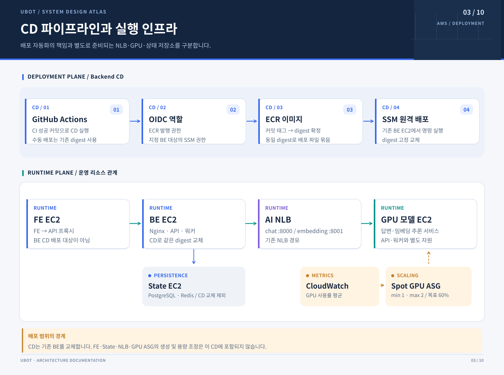
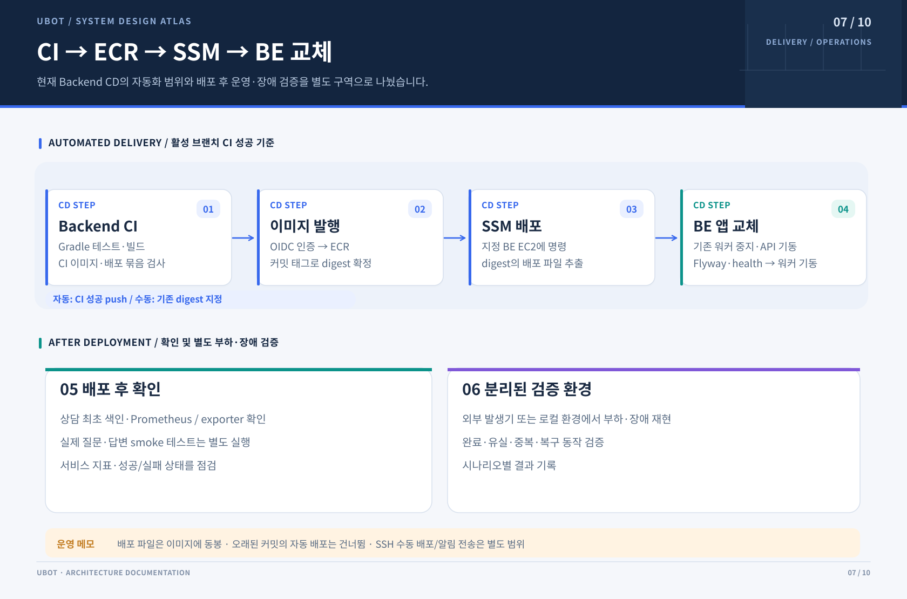

# 배포





> 현재 코드 기준: UBot-BE `develop` `4a7a546f` · 확인일: 2026-10-26

## AWS CI/CD 흐름

현행 AWS 경로는 `Backend CI`가 배포 브랜치의 push에서 성공하면 `AWS PoC BE CD`가 그 정확한 커밋을 ECR에 발행하고, 이미지 digest를 고정해 SSM으로 BE EC2를 교체합니다. PR의 CI 성공만으로는 배포하지 않으며 `AWS_BE_DEPLOY_ENABLED=true`여야 합니다. 수동 실행은 새 이미지를 빌드하지 않고 이미 ECR에 발행된 digest를 재배포합니다.

```text
Backend CI 성공(push)
  → OIDC 역할 획득
  → 동일 commit 이미지 ECR 발행·digest 확정
  → aws-poc environment
  → SSM AWS-RunShellScript
  → API/Flyway → Nginx → Worker → 상담 색인 → 관측 확인
```

이 경로가 배포하는 것은 BE EC2의 API·Worker·Nginx·관측 도구입니다. PostgreSQL·Redis는 별도 State EC2, 답변·임베딩 모델은 NLB 뒤 GPU 서버를 사용하며 `AI_RUNTIME_MANAGED=false`입니다. FE·State·NLB·GPU ASG의 생성이나 용량 변경은 이 CD의 범위가 아닙니다.

자동 배포는 대상 브랜치가 여전히 같은 commit인지 다시 확인해 오래된 실행의 역전 배포를 막습니다. API health·공지 조회·Worker 기동·scrape 대상은 확인하지만 로그인 질문부터 최종 LLM 답변까지의 smoke test와 자동 이미지 롤백은 수행하지 않습니다. 실행 조건과 명령의 기준은 [AWS 배포 workflow](../.github/workflows/aws-be-deploy.yml)와 `tools/deploy/aws-be-deploy.sh`입니다.

### 배포 중단 후 Worker 복구

배포는 Worker를 멈추기 전에 EC2에 `ubot-be-worker-recovery.timer`를 설치합니다. SSM·배포 셸이 종료돼도 systemd가 30초 간격으로 Worker를 확인하며, API가 정상 응답할 때 API와 같은 digest의 릴리스 파일로 멈췄거나 사라진 Worker를 다시 올립니다. 실행 중인 구버전 Worker도 API 버전에 맞춥니다. API가 꺼졌거나 마이그레이션에 실패했다면 Worker를 시작하지 않습니다.

배포와 복구는 `.deploy/deploy.lock`을 공유하므로 배포 중에는 복구가 개입하지 않습니다. 배포 프로세스가 강제 종료되면 잠금이 풀리고 다음 확인에서 복구합니다. SSM 배포 명령은 최대 20분 후 종료 신호를 보내고 30초 뒤 강제 종료해 잠금이 계속 남는 것을 막습니다. 복구가 성공해도 실패한 CD 실행의 결과는 실패로 유지됩니다.

```bash
sudo systemctl status ubot-be-worker-recovery.timer
sudo journalctl -u ubot-be-worker-recovery.service --since '10 minutes ago'
```

Worker를 수동으로 멈춰 점검할 때는 먼저 배포 루트(기본 `/home/ssm-user/ubot-api`)에서 `touch .deploy/worker-recovery.paused`로 자동 복구를 멈춥니다. 점검 후 `rm .deploy/worker-recovery.paused`로 다시 켭니다. 정상 실행 중이거나 재시작 중인 같은 버전의 Worker와 `docker pause`로 정지한 Worker는 변경하지 않습니다. 기존 작업 회수·재처리는 다시 기동한 Worker 안의 복구 루프가 담당합니다.

## 기존 SSH/SCP 수동 CD

아래 절은 `Backend Manual CD`와 로컬 배포 형태를 위한 기존 절차입니다. AWS ECR·SSM 경로와 섞어 해석하지 않습니다. 같은 구성 파일로 로컬에서 배포 형태를 재현할 수도 있습니다.

## 배포 범위

- `push`·`pull_request` 자동 배포 트리거는 두지 않고 `workflow_dispatch` 수동 실행만 씁니다.
- CD는 백엔드, Nginx, 공통 서비스(PostgreSQL, Redis, Prometheus)를 올립니다. 서버 `.env`의 `AI_RUNTIME_MANAGED`가 `true`면 모델 서버(Ollama, vLLM)도 같은 서버에 함께 띄웁니다.
- 서버에서 하는 일은 저장소의 `tools/deploy/deploy.sh`에 있고, 워크플로는 이 스크립트를 서버로 보내 실행합니다.
- 무엇을 띄울지는 워크플로 입력이 아니라 서버의 `~/ubot/.env`가 정합니다. `AI_MODE`가 모델 서버 종류를, `AI_RUNTIME_MANAGED`가 모델 서버를 이 서버에 띄울지를 정합니다.
- `develop`, `main` 브랜치에서만 실행됩니다. 다른 브랜치로 실행하면 job이 건너뛰어집니다.
- 도메인·HTTPS 적용, 서버 자동 시작·중지는 후속 작업입니다(#60, #88). WebSocket용 Nginx 설정은 WebSocket endpoint가 정해진 뒤 적용합니다(#77).

## 구성 파일

| 파일 | 역할 |
|---|---|
| `Dockerfile` | 애플리케이션 이미지. `eclipse-temurin:21-jdk`에서 `bootJar`로 빌드하고 `21-jre`로 실행 |
| `.dockerignore` | `.env`, `.git`, 빌드 산출물, IDE 설정, 키 파일을 이미지 빌드 컨텍스트에서 제외 |
| `docker-compose.yml` | 공통 서비스 (`postgres`, `redis`, `prometheus`) |
| `docker-compose.deploy.yml` | `backend`, `ai-worker`, `nginx` 서비스 정의와 배포용 Prometheus 설정 마운트. 공통 파일과 함께 사용 |
| `docker-compose.ollama.yml` | Ollama 모델 서버 (`ollama`, `ollama-init`). 모델 서버를 이 서버에 띄우고 Ollama를 쓰는 엔진이 있을 때 함께 사용 |
| `docker-compose.vllm.yml`, `infra/llm/docker-compose.yml` | vLLM 모델 서버 (`vllm`, `vllm-embedding`). 모델 서버를 이 서버에 띄우고 vLLM을 쓰는 엔진이 있을 때 함께 사용 |
| `docker-compose.deploy.local.yml` | [로컬에서 배포 형태를 재현](#로컬에서-배포-형태-실행하기)할 때만 사용. 서버에는 올리지 않음 |
| `infra/nginx/nginx.conf` | 80 포트의 모든 요청을 `backend:8080`으로 프록시. `/api` 접두사 제거와 게스트 채팅 속도 제한 포함 |
| `infra/prometheus/prometheus.deploy.yml` | 배포용 Prometheus 수집 설정. 같은 Compose 네트워크의 `backend:8080`을 수집 |
| `src/main/resources/application-prod.yml` | 운영 프로필 설정. health 상세 숨김, Swagger 끔, graceful shutdown |
| `tools/deploy/deploy.sh`, `tools/deploy/lib/` | 서버에서 실행되는 배포 스크립트. `deploy.sh`에는 [실행 순서](#워크플로우-단계)만 있고, 단계별 함수는 `lib/` 아래 다섯 파일에 있음 (`env.sh` 설정 검증, `compose.sh` Compose 구성, `ai-runtime.sh` 모델 서버, `embeddings.sh` 벡터 확인·백필, `backend.sh` 백엔드 교체) |
| `.github/workflows/cd-manual.yml` | 이미지 빌드 → EC2 전송 → 서버에서 `deploy.sh` 실행 |

### 서비스 구성

```text
인터넷 ──:80──▶ nginx ──▶ backend:8080 ──▶ postgres:5432, redis:6379 (작업 스트림 chat:jobs)
                                                     ▲
                                       ai-worker ────┘
                                           └──▶ 모델 서버 (AI_MODE에 따라 Ollama 또는 vLLM)
```

- `backend`는 호스트 포트를 열지 않고(`expose: 8080`) Compose 네트워크 안에서만 접근됩니다. 외부 요청은 `nginx`를 거칩니다.
- `backend`는 `.env`를 `env_file`로 읽습니다. Compose는 DB·Redis의 내부 주소, 프로세스 역할, Prometheus 주소를 지정하고 `COUNSEL_SEED_ON_START=false`로 API 기동 시 색인을 끕니다. 상담 색인은 CD의 일회성 작업에서 실행합니다. 프로필(`SPRING_PROFILES_ACTIVE`)과 모델 서버 주소는 `.env`에 적은 값이 그대로 들어갑니다.
- `backend`는 `APP_ROLE=api`로, `ai-worker`는 같은 이미지를 `APP_ROLE=worker`로 띄웁니다. `backend`는 질문을 `chat_jobs`에 넣고 Redis Streams(`chat:jobs`)에 작업 메시지를 발행한 뒤 `202`로 답합니다. `ai-worker`가 메시지를 읽어 답변을 만들고, 모델 서버는 `ai-worker`만 호출합니다. 랭킹·보관 기간 삭제 스케줄러는 `backend`에서만 돕니다.
- `ai-worker`는 포트를 열지 않고, `backend`와 같은 `.env`와 Compose 덮어쓰기 값을 씁니다. 같은 이미지라 API 코드도 함께 뜨지만 HTTP는 `/actuator`만 받고 나머지는 `404 G-004`로 거절하므로, 요청이 잘못 `ai-worker`로 가도 API처럼 처리되지 않습니다.
- 모델 서버에 동시에 들어가는 요청은 `ai-worker` 하나당 `CHAT_WORKER_CONCURRENCY`개까지입니다. DB 선점과 실행 토큰으로 결과의 중복 저장을 막습니다. 장애 회수 시 모델 호출은 재실행될 수 있습니다. 프로세스마다 DB 연결을 `DB_POOL_MAX_SIZE`개까지 씁니다.
- `backend`는 `postgres`, `redis`가 healthy가 된 뒤 시작합니다. 기동 시 Flyway가 마이그레이션을 적용합니다. 모델 서버는 기다리지 않으며, 배포 스크립트가 모델 서버를 먼저 준비하고 확인한 뒤 `backend`를 올립니다.
- 이미지 이름은 `BACKEND_IMAGE` 환경변수로 지정합니다. 기본값은 `ubot-be:local`이고, CD는 `ubot-be:<커밋 SHA>`로 덮어씁니다.
- `nginx`는 `proxy_read_timeout 180s`를 씁니다. 채팅은 접수 즉시 `202`로 답하므로 이 값에 걸리지 않습니다. `X-Real-IP`, `X-Forwarded-For`, `X-Forwarded-Proto` 헤더를 넘깁니다. 임베딩 백필 경로(`/admin/faqs/embeddings/backfill`, `/admin/unanswered-groups/embeddings/backfill`과 `/api`가 붙은 같은 경로)만 3600초입니다.
- `nginx`는 `/api/`로 시작하는 요청에서 `/api`를 떼고 `backend`로 넘깁니다(`/api/chat/questions` → `/chat/questions`). UBot-FE의 공용 API 클라이언트가 `/api` 접두사를 붙여 호출하기 때문입니다. 접두사 없는 경로도 그대로 프록시합니다.
- `nginx`는 `/chat/`와 `/api/chat/` 경로의 게스트 요청(`Authorization: Bearer …` 형식의 헤더가 없는 요청)에만 IP별 요청 속도 제한을 겁니다. 회원 요청은 제한하지 않습니다. `.env`의 `CHAT_GUEST_RATE_LIMIT_RATE`(기본 `30r/m`)와 `CHAT_GUEST_RATE_LIMIT_BURST`(기본 `10`)로 조절하며, 넘으면 백엔드로 넘기지 않고 `429 RATE-001`을 반환합니다. 답변 상태 조회(`/chat/jobs/`, `/api/chat/jobs/`)는 짧은 간격으로 반복 호출하므로 이 제한에서 뺐습니다. `nginx.conf`는 컨테이너 시작 시 이 환경변수를 채워 넣는 템플릿으로 마운트되므로, 값을 바꾼 뒤에는 `nginx`를 다시 만들어야 합니다.
- `prometheus`는 배포 구성에서 `backend:8080`의 `/actuator/prometheus`를 수집합니다. 로컬 개발용 설정(`infra/prometheus/prometheus.yml`)은 호스트에서 실행하는 백엔드를 보므로, 배포 파일이 `prometheus.deploy.yml`로 바꿔 마운트합니다. 이 경로는 Nginx가 외부 요청에 404로 막습니다.
- `ollama-init`을 뺀 모든 서비스에 `restart: unless-stopped`가 있어 서버가 재부팅되면 다시 뜹니다. 배포 스크립트가 멈춰 둔 모델 서버는 다시 뜨지 않습니다.

## 서버의 `.env`

서버의 `~/ubot/.env`가 배포 구성을 정합니다. `.env.example`을 바탕으로 만들되 개발용 `.env`를 그대로 복사하지 말고, 비밀 값과 아래 값을 서버에 맞게 넣습니다. 배포 스크립트는 맨 먼저 이 파일을 검사하고, 맞지 않으면 컨테이너를 건드리기 전에 실패합니다.

| 조건 | 있어야 하는 키 |
|---|---|
| 항상 | `SPRING_PROFILES_ACTIVE`(`prod`여야 함), `AI_MODE`, `AI_RUNTIME_MANAGED`, `EMBEDDING_PROFILE_VERSION`(1 이상의 정수), `POSTGRES_DB`, `POSTGRES_USER`, `POSTGRES_PASSWORD`, `POSTGRES_PORT`, `REDIS_PORT`, `PROMETHEUS_PORT`, `JWT_SECRET`, `KAKAO_REST_API_KEY` |
| `AI_MODE=custom` | `AI_CHAT_ENGINE`, `AI_EMBEDDING_ENGINE` (각각 `ollama` 또는 `vllm`). 다른 모드에서는 이 둘이 비어 있어야 함 |
| 답변 생성 엔진이 Ollama | `OLLAMA_BASE_URL`, `OLLAMA_CHAT_MODEL` |
| 임베딩 엔진이 Ollama | `OLLAMA_BASE_URL`, `OLLAMA_EMBEDDING_MODEL` |
| 답변 생성 엔진이 vLLM | `LLM_BASE_URL`, `LLM_MODEL` |
| 임베딩 엔진이 vLLM | `EMBEDDING_BASE_URL`, `EMBEDDING_MODEL` |

`AI_MODE`가 `ollama`나 `vllm`이면 두 엔진이 모두 그 값이고, `custom`이면 `AI_CHAT_ENGINE`, `AI_EMBEDDING_ENGINE`을 따릅니다. 값은 소문자로 적습니다.

모델 서버를 이 서버에 함께 띄우면(`AI_RUNTIME_MANAGED=true`) 아래 조건이 더 붙습니다. vLLM을 쓰는 엔진이 하나라도 있으면 서버에서 `nvidia-smi`가 동작해야 합니다.

| 엔진 | 더 있어야 하는 키 | 값 조건 |
|---|---|---|
| Ollama | `OLLAMA_PORT` | `OLLAMA_BASE_URL`이 `http://ollama:11434` |
| vLLM 답변 생성 | `LLM_PORT`, `LLM_HF_MODEL`, `LLM_SERVED_MODEL_NAME` | `LLM_BASE_URL`이 `http://vllm:8000/v1`, `LLM_MODEL`이 `LLM_SERVED_MODEL_NAME`과 같음 |
| vLLM 임베딩 | `EMBEDDING_PORT`, `EMBEDDING_HF_MODEL`, `EMBEDDING_SERVED_MODEL_NAME` | `EMBEDDING_BASE_URL`이 `http://vllm-embedding:8000/v1`, `EMBEDDING_MODEL`이 `EMBEDDING_SERVED_MODEL_NAME`과 같음 |

- `AI_RUNTIME_MANAGED`는 `true` 또는 `false`입니다. `true`면 배포 스크립트가 모델 서버를 이 서버에 띄우고, `false`면 띄우지 않고 `.env`의 주소로 다른 곳의 모델 서버를 호출합니다. `custom`에서도 `true`를 쓸 수 있고, 그때는 필요한 모델 서버만 띄웁니다.
- 백엔드는 컨테이너 안에서 실행되므로 `localhost`는 백엔드 자신을 가리킵니다. 그래서 모델 서버를 함께 띄울 때는 주소가 위 표의 Compose 서비스 이름 주소와 정확히 같아야 합니다.
- 다른 곳의 모델 서버를 쓸 때는 주소 형식을 검사하지 않습니다. 대신 배포 중에 백엔드와 같은 Docker 네트워크에서 그 주소를 실제로 호출해, `.env`에 적은 모델 이름이 보이는지 확인합니다.

```dotenv
# vLLM을 이 서버에 함께 띄우는 경우 (나머지 키는 .env.example 참고)
SPRING_PROFILES_ACTIVE=prod
AI_MODE=vllm
AI_RUNTIME_MANAGED=true
LLM_BASE_URL=http://vllm:8000/v1
LLM_MODEL=ubot-chat
LLM_HF_MODEL=RedHatAI/Qwen3-4B-Instruct-2507-quantized.w4a16
LLM_SERVED_MODEL_NAME=ubot-chat
EMBEDDING_BASE_URL=http://vllm-embedding:8000/v1
EMBEDDING_MODEL=ubot-embedding
EMBEDDING_SERVED_MODEL_NAME=ubot-embedding
```

```dotenv
# 다른 GPU 서버의 vLLM을 호출하는 경우
SPRING_PROFILES_ACTIVE=prod
AI_MODE=vllm
AI_RUNTIME_MANAGED=false
LLM_BASE_URL=http://<GPU 서버 주소>:8000/v1
EMBEDDING_BASE_URL=http://<GPU 서버 주소>:8001/v1
```

## 로컬에서 배포 형태 실행하기

로컬에는 GPU가 없는 경우가 많아 Ollama 구성으로 재현합니다. `.env`의 `AI_MODE`가 `ollama`인 상태에서 실행합니다.

```powershell
docker build -t ubot-be:local .
docker compose -f docker-compose.yml -f docker-compose.ollama.yml -f docker-compose.deploy.yml -f docker-compose.deploy.local.yml up -d
```

- 마지막의 `docker-compose.deploy.local.yml`은 로컬 재현 전용입니다. 로컬 `.env`의 `OLLAMA_BASE_URL`은 `http://localhost:11435`인데, 컨테이너 안에서 `localhost`는 백엔드 자신이라 Ollama를 찾지 못합니다. 이 파일이 백엔드의 모델 서버 주소를 Compose 서비스 이름(`http://ollama:11434` 등)으로 바꾸고, 프로필을 서버와 같은 `prod`로 맞춥니다. `.env`는 고치지 않아도 됩니다.
- 서버에서는 이 파일을 쓰지 않습니다. 서버의 `.env`에 처음부터 서비스 이름 주소를 적고, 배포 스크립트가 그 값을 검사합니다.
- 빌드는 컨테이너 안에서 Gradle을 실행하므로 로컬에 Java가 없어도 됩니다. 대신 매번 의존성을 새로 받습니다. 호스트의 80 포트가 비어 있어야 합니다.

확인 (Nginx를 거치므로 8080이 아니라 80 포트):

```powershell
docker compose -f docker-compose.yml -f docker-compose.ollama.yml -f docker-compose.deploy.yml -f docker-compose.deploy.local.yml ps
curl.exe http://localhost/actuator/health
```

## 수동 CD (`Backend Manual CD`)

### 실행 방법

GitHub → Actions → `Backend Manual CD` → `Run workflow`에서 브랜치를 골라 실행합니다. 입력값은 없습니다.

- GitHub Environment `staging`을 사용합니다. Environment에 보호 규칙이 있으면 승인 후 진행됩니다.
- 동시에 하나만 실행되며(`concurrency: ubot-backend-deploy`), 뒤에 실행한 것은 앞 배포가 끝날 때까지 기다립니다. 제한 시간은 60분입니다.

### 필요한 Secrets

| Secret | 값 |
|---|---|
| `EC2_HOST` | 배포 서버 호스트 |
| `EC2_USER` | SSH 사용자 |
| `EC2_SSH_KEY` | SSH 개인 키 (PEM 전체) |

### 워크플로우 단계

GitHub Actions에서 하는 일:

1. `docker build`로 `ubot-be:<커밋 SHA>` 이미지를 만들고 `docker save`로 압축합니다.
2. 배포에 필요한 파일이 저장소에 다 있는지 확인하고 `tools/deploy` 아래 스크립트의 문법을 검사합니다(`bash -n`).
3. Compose 파일 4개(`docker-compose.yml`, `docker-compose.deploy.yml`, `docker-compose.ollama.yml`, `docker-compose.vllm.yml`)와 `infra/postgres/Dockerfile`, `infra/nginx/nginx.conf`, `infra/prometheus/prometheus.yml`, `infra/prometheus/prometheus.deploy.yml`, `infra/llm/docker-compose.yml`, `tools/deploy/` 폴더를 묶습니다.
4. SSH 연결을 설정하고 확인한 뒤, 두 압축 파일을 서버의 `~/ubot-deploy/`로 복사합니다.
5. 서버에서 구성 파일을 `~/ubot`에 풀고 `tools/deploy/deploy.sh`를 실행합니다.

서버에서 `deploy.sh`가 하는 일(Compose 프로젝트 이름은 `ubot`):

1. `~/ubot/.env`를 검사합니다([서버의 `.env`](#서버의-env)). 맞지 않으면 여기서 끝납니다.
2. 이미지를 `docker load`합니다.
3. 쓸 Compose 파일을 정하고 `config`로 조합이 유효한지 확인합니다. 공통 파일과 배포 파일은 항상 쓰고, 모델 서버를 이 서버에 띄우면 쓰는 엔진의 모델 서버 파일을 더합니다.
4. 이번 구성에서 쓰지 않는 모델 서버를 멈춥니다. `AI_RUNTIME_MANAGED=false`면 `ollama`, `vllm`, `vllm-embedding`을 모두 멈추고, 아니면 쓰지 않는 쪽만 멈춥니다. 컨테이너와 볼륨은 지우지 않습니다.
5. `postgres`, `redis`, `prometheus`를 올립니다. `postgres` 이미지가 서버에 없으면 `infra/postgres/Dockerfile`로 빌드합니다.
6. 모델 서버를 이 서버에 띄우는 구성이면 모델 서버를 올립니다. Ollama는 healthy가 될 때까지 기다린 뒤 `ollama-init`을 끝까지 실행하므로, 모델을 다 내려받은 뒤에 다음으로 넘어갑니다. vLLM은 쓰는 서비스(`vllm`, `vllm-embedding`)만 올립니다.
7. 모델 서버가 준비됐는지 확인합니다. 백엔드와 같은 Docker 네트워크에 `curl` 컨테이너를 띄워 Ollama의 `/api/tags`나 vLLM의 `/v1/models`를 호출하고, `.env`에 적은 모델 이름이 응답에 있는지 봅니다. 답변 생성과 임베딩을 따로 확인합니다.
   - 5초 간격으로 다시 시도합니다. 제한 시간은 이 서버에 띄운 모델 서버면 1200초, 다른 곳의 모델 서버면 60초입니다.
   - 이 서버에 띄운 모델 서버는 컨테이너가 종료됐거나 두 번 이상 재시작하면 제한 시간을 기다리지 않고 실패합니다.
   - 실패하면 그 컨테이너의 상태와 로그 200줄을 출력합니다.
8. FAQ 벡터를 준비합니다. 활성 FAQ마다 원본 질문의 활성 variant가 있는지, 활성 variant마다 현재 Embedding Profile과 FAQ 버전의 `QUESTION` 벡터가 있는지 확인합니다. FAQ가 없거나 벡터가 다 있으면 그대로 넘어갑니다. 모자라면 새 이미지로 백필만 하고 끝나는 임시 백엔드를 띄웁니다(`docker compose run ... backend --app.embedding-backfill.run=true`).
   - 임시 백엔드는 Nginx 트래픽을 받지 않고 DB 스키마도 바꾸지 않습니다. 이 동안 기존 백엔드가 계속 서비스합니다.
   - 백필이 끝나면 다시 확인하고, 벡터가 다 있어야 다음으로 넘어갑니다.
   - 백필이 실패하면 여기서 끝납니다. 기존 백엔드와 Nginx는 그대로입니다.
   - variant 테이블이 아직 없거나 적용되지 않은 마이그레이션이 있으면 임시 백엔드는 백필하지 않고 끝납니다. 이때는 교체를 먼저 하고 12번에서 백필합니다.
9. 상담이 켜져 있으면 워커 교체 전에 일회성 `backend`로 마이그레이션을 검사합니다(`--counsel.seed-on-start=true --counsel.seed-only=true --counsel.seed-check-only=true`). 이 실행은 스키마 변경·스케줄러·색인을 실행하지 않습니다. 미적용 항목이 있으면 종료 코드 3으로 색인을 미루며 기존 API·워커를 유지합니다. 미적용 항목이 없으면 새 `ai-worker`의 헬스 확인 후 `--counsel.seed-on-start=true --counsel.seed-only=true`로 색인과 워커·활성 벡터를 검증합니다. 이후 `backend`와 `ai-worker`를 올리고 `nginx`를 강제로 다시 만듭니다(`--no-deps --force-recreate`). 실제 API·워커 기동에서만 Flyway가 DB 잠금으로 마이그레이션을 적용합니다. 미뤄진 상담 색인은 13번에서 실행합니다.
10. `http://127.0.0.1/actuator/health`를 5초 간격으로 최대 30회 확인합니다. 실패하면 컨테이너 상태와 `backend`·`nginx` 로그 200줄을 출력하고 실패로 끝납니다. 이어서 같은 Docker 네트워크에 `curl` 컨테이너를 띄워 `http://ai-worker:8080/actuator/health`를 같은 방식으로 확인하고, 실패하면 `ai-worker`의 상태와 로그 200줄을 출력하고 실패로 끝납니다.
11. 오래된 백엔드 이미지를 지웁니다. 지금 이미지와 그 전 이미지 2개는 남깁니다.
12. 교체 뒤에 FAQ 벡터를 다시 확인합니다.
    - 8번에서 백필을 미뤘다면 임시 백엔드를 다시 띄워 백필하고 확인합니다. 실패하면 배포를 실패로 끝냅니다.
    - 그렇지 않으면 확인만 하고, 그 사이 등록·수정된 FAQ의 벡터가 모자라면 경고만 출력합니다.
13. 9번에서 상담 색인을 미뤘다면 일회성 `backend`로 색인합니다(`--counsel.seed-on-start=true --counsel.seed-only=true`). 12번 다음에 실행하므로 상담 색인이 실패해도 FAQ 백필은 이미 끝나 있습니다. 실패하면 배포를 실패로 끝냅니다. 새 API는 실행 중이며, 처음 색인하는 배포였다면 색인이 끝날 때까지 상담 메시지가 `CHECK_FAILED`로 처리돼 전달되지 않습니다. 원인을 해결한 뒤 배포를 재시도합니다.
14. 컨테이너 상태를 출력합니다.

### 서버 사전 준비 (최초 1회)

- Docker와 Docker Compose 플러그인을 설치합니다. vLLM을 이 서버에 띄우려면 Compose 2.24.4 이상이 필요합니다.
- health check에 쓰는 `curl`이 서버에 있어야 합니다.
- 서버가 Docker Hub에서 이미지를 받을 수 있어야 합니다. 배포 스크립트가 모델 서버 확인에 `curlimages/curl` 이미지를 씁니다.
- `~/ubot/.env`를 만듭니다([서버의 `.env`](#서버의-env)).
- 보안 그룹에서 80 포트를 엽니다.
- vLLM을 이 서버에 띄우려면 NVIDIA 드라이버와 NVIDIA Container Toolkit을 설치해 `nvidia-smi`와 컨테이너의 GPU 사용이 되게 합니다.
- 다른 서버의 모델 서버를 호출하려면(`AI_RUNTIME_MANAGED=false`) 그 서버의 포트가 백엔드 서버에서 접근 가능해야 합니다. vLLM은 답변 생성(8000)과 임베딩(8001) 두 포트가 필요합니다.

모델은 모델 서버가 처음 뜰 때 내려받습니다.

- **Ollama**: `ollama-init`이 `.env`의 `OLLAMA_EMBEDDING_MODEL`과 `OLLAMA_CHAT_MODEL` 중 서버에 없는 모델만 받습니다. 배포 스크립트는 내려받기가 끝날 때까지 기다립니다. 큰 채팅 모델을 처음 받는 배포는 워크플로 제한 시간 60분에 걸릴 수 있습니다.
- **vLLM**: 컨테이너가 Hugging Face에서 모델을 받은 뒤에 응답을 시작합니다. 첫 배포에서 내려받는 시간이 준비 확인 제한(1200초)을 넘으면 실패합니다. 컨테이너는 계속 내려받고 있으므로 다시 실행하면 됩니다. 받은 모델은 `llm_hf-cache` 볼륨에 남습니다.

Ollama에 모델이 받아졌는지는 아래 명령으로 확인합니다.

```bash
cd ~/ubot
docker compose -p ubot --env-file .env -f docker-compose.yml -f docker-compose.deploy.yml -f docker-compose.ollama.yml exec ollama ollama list
```

### 서버에서 상태 확인·롤백

Compose 명령은 항상 프로젝트 이름, `.env`, 배포에 쓴 파일을 함께 지정합니다. 아래는 공통 구성이고, 모델 서버를 이 서버에 띄웠다면 `-f docker-compose.ollama.yml` 또는 `-f docker-compose.vllm.yml`을 덧붙입니다.

```bash
cd ~/ubot
docker compose -p ubot --env-file .env -f docker-compose.yml -f docker-compose.deploy.yml ps -a
docker compose -p ubot --env-file .env -f docker-compose.yml -f docker-compose.deploy.yml logs --tail=200 backend
docker compose -p ubot --env-file .env -f docker-compose.yml -f docker-compose.deploy.yml logs --tail=200 ai-worker
```

서버에는 지금 이미지와 그 전 이미지 2개가 남습니다. 그래서 되돌릴 수 있는 범위는 직전 두 번의 배포까지입니다. 이전 커밋으로 되돌리려면 그 태그로 `backend`와 `ai-worker`를 다시 올립니다.

```bash
docker image ls ubot-be
BACKEND_IMAGE=ubot-be:<이전 커밋 SHA> docker compose -p ubot --env-file .env -f docker-compose.yml -f docker-compose.deploy.yml up -d backend ai-worker
BACKEND_IMAGE=ubot-be:<이전 커밋 SHA> docker compose -p ubot --env-file .env -f docker-compose.yml -f docker-compose.deploy.yml up -d --no-deps --force-recreate nginx
```

`~/ubot-deploy/`의 압축 파일은 배포할 때마다 같은 이름으로 덮어씁니다.

## 주의할 점

- **임베딩 설정을 바꾸면 배포가 교체 전에 벡터를 채웁니다.** `AI_MODE`, 임베딩 모델, `EMBEDDING_PROFILE_VERSION` 중 하나를 바꾸면 새 Embedding Profile에는 벡터가 없으므로, 배포 스크립트가 임시 백엔드로 활성 variant의 누락된 `QUESTION` 벡터를 백필한 뒤에 교체합니다. 소요 시간은 활성 variant 수와 누락된 벡터 수에 따라 달라집니다.
    - 같은 배포에 아직 적용되지 않은 마이그레이션이 있으면 교체가 먼저입니다. 이때는 백필이 끝날 때까지 채팅 검색 결과가 없습니다. 피하려면 코드를 먼저 배포하고, 임베딩 설정은 그다음에 바꿔 다시 배포합니다.
    - 모델 서버 종류를 바꾸는 배포에서는 기존 모델 서버를 먼저 멈추므로, 백필이 도는 동안 기존 백엔드의 채팅이 실패합니다.
    - 교체 뒤 백필이 실패해 배포가 실패로 끝났다면 새 백엔드는 이미 떠 있습니다. 원인을 해결한 뒤 다시 배포하거나 아래 스크립트로 채웁니다([백필](how-to/llm-module.md#백필)).

```powershell
.\tools\faq-db\backfill-embeddings.ps1 -Email <관리자 이메일> -BaseUrl http://<서버 주소>
```

- 배포된 백엔드는 `prod` 프로필로 실행됩니다. Swagger UI와 API 문서가 꺼져 있고, `/actuator/health`는 상세 없이 상태만 반환합니다.
- Nginx는 HTTP 80만 사용합니다. TLS(HTTPS) 설정은 없습니다(후속 작업).
- Nginx는 `server` 블록에서 보안 응답 헤더(`X-Content-Type-Options`, `X-Frame-Options`, `Referrer-Policy`)를 붙입니다. `location` 블록에 `add_header`를 하나라도 추가하면 그 location에서는 `server` 블록의 헤더가 모두 빠지므로, 세 줄을 함께 넣어야 합니다.
- 로그인 실패 제한은 Nginx가 넘기는 `X-Real-IP`로 IP를 셉니다. Nginx 앞에 로드밸런서를 두면 모든 요청이 로드밸런서 IP로 보여 한 사람의 실패로 전체 로그인이 막힐 수 있습니다. 이때는 Nginx에 `set_real_ip_from <로드밸런서 대역>`과 `real_ip_header X-Forwarded-For`를 함께 설정합니다.
- 백엔드를 여러 대 띄우면 모두 같은 Redis를 써야 합니다. 로그인 실패 횟수, 로그아웃 차단, 랭킹, ShedLock이 Redis에 있습니다.
- 백엔드만 새로 띄우고 Nginx를 그대로 두면 Nginx가 이전 백엔드 주소로 요청을 보내 502가 날 수 있습니다(#77 리뷰). 그래서 배포 스크립트는 백엔드 교체 뒤 Nginx를 강제로 다시 만듭니다. 서버에서 손으로 백엔드를 교체했다면 Nginx도 다시 만드세요.

```bash
docker compose -p ubot --env-file .env -f docker-compose.yml -f docker-compose.deploy.yml up -d --no-deps --force-recreate nginx
```

- `ai-worker`를 멈추면(배포로 교체할 때 포함) 새 메시지는 읽지 않고, 실행 중인 답변은 최대 `CHAT_WORKER_SHUTDOWN_WAIT`(기본 20초) 동안 끝까지 만들어 저장합니다. 그 안에 끝나지 않은 답변은 `QUEUED`로 돌려놓고 메시지를 다시 발행합니다. 아직 시작하지 않은 질문은 스트림에 남았다가 새 `ai-worker`가 처리합니다. 접수 뒤 `CHAT_WORKER_MAX_QUEUE_WAIT`(기본 10분) 안에 시작하지 못하면 `CHAT-016`으로 실패합니다.
- `ai-worker`가 강제로 죽으면(OOM, `docker kill` 등) 그 Worker가 실행하던 작업은 `RUNNING`으로, 메시지는 처리 대기 목록에 남습니다. 다른 Worker(또는 새로 뜬 Worker)가 그 작업의 heartbeat가 `CHAT_WORKER_HEARTBEAT_TIMEOUT`(기본 1분) 넘게 끊긴 것을 보고 메시지를 넘겨받아 다시 실행하므로, 그 질문은 1분 남짓 늦어지고 LLM을 한 번 더 부릅니다. 같은 작업으로 3번 죽으면 다시 실행하지 않고 `CHAT-015`로 끝냅니다.
- Redis 메시지를 잃어도 새 작업의 좌표·지역과 성공 결과는 DB에 남습니다. QUEUED 작업은 재발행하고, 살아 있는 RUNNING 작업은 heartbeat와 실행 제한을 유지합니다. 죽은 워커의 메시지까지 잃은 경우 마지막 heartbeat 10분 뒤 실패 처리합니다. Redis 영속성은 여전히 복구 지연을 줄이는 운영 설정입니다.
- DB 마이그레이션은 `backend` 기동 시 자동 적용됩니다. 되돌릴 수 없는 마이그레이션이 포함된 배포는 이미지 롤백만으로 DB가 되돌아가지 않습니다.
- DB 데이터와 받아 둔 모델은 Compose 볼륨에 저장됩니다. `docker compose down -v`는 명령에 지정한 Compose 파일의 볼륨을 모두 삭제합니다.

Worker의 V33 마이그레이션, 장애 재현 테스트, 지표, 롤백 절차는 [Worker 장애 복구와 검증](how-to/worker-reliability.md)을 참고하세요.
