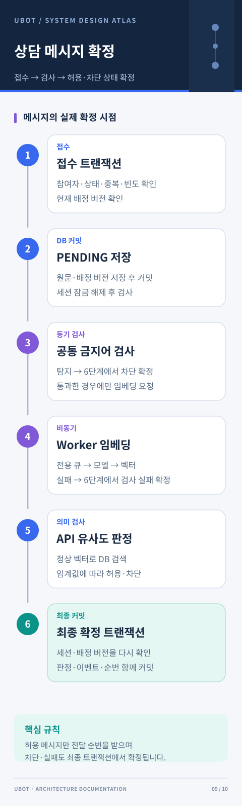

# 상담사 연결

로그인한 회원이 AI 대화 중에 상담사를 호출하고, 상담사가 그 대화의 이전 문답을 보며 상담을 이어가는 기능입니다. 코드는 `com.ubot.counsel`에 있고 기존 Spring Boot 프로세스(API·ai-worker)에서 동작합니다. 고객 FE는 `/ai`, 상담사 화면은 `/counselor`이며, FE의 `/api/counsel/**` 요청은 기존 `/api` 프록시를 거쳐 BE `/counsel/**`로 갑니다.

## 처리 흐름

1. 기존 `JwtAuthenticationFilter`가 토큰과 현재 DB 사용자를 확인합니다. 역할은 토큰이 아니라 DB 값을 따르므로, 관리자가 상담사 권한을 회수하면 다음 요청부터 바로 적용됩니다.
2. 고객이 상담을 요청하면 `HandoffHistoryService`가 그 대화의 저장된 AI 문답과 FAQ 선택 저장본, 같은 대화의 이전 상담 메시지(허용된 것만)를 서버에서 조회해 인계 이력으로 저장합니다. 클라이언트가 보낸 문답 본문은 사용하지 않습니다.
3. 상담 생성·이력 저장·배정을 한 트랜잭션에서 처리합니다. 상담사는 대기 순서(`waiting_since`)대로 배정되며, 상담사 연결이 끊겨 다시 대기로 돌아간 상담도 원래 대기 순서를 유지합니다.
4. 메시지는 먼저 `PENDING`으로 저장한 뒤 검사합니다. 검사하는 동안 트랜잭션과 세션 잠금을 잡지 않습니다.
5. 검사는 기존 금지어 필터(`ForbiddenWordFilterService`)를 먼저 거칩니다. 금지어가 있으면 임베딩 없이 `BLOCKED`입니다.
6. 금지어를 통과하면 ai-worker의 상담 전용 큐로 임베딩을 요청하고, 활성 금지 문장 벡터와의 최고 유사도가 임계값(`COUNSEL_BLOCK_THRESHOLD`) 이상이면 `BLOCKED`, 미만이면 `ALLOWED`입니다. 검사가 실패하면 `CHECK_FAILED`이며, `ALLOWED`만 상대방에게 전달됩니다.

인계 이력은 **상담을 요청한 대화**의 요청 시점 기록입니다. 계정의 다른 대화는 넘기지 않습니다. 상담사가 재배정되면 이전 상담사는 이력과 메시지를 읽을 수 없고, 상담이 끝난 뒤에는 고객과 마지막 담당 상담사만 읽을 수 있습니다.

## 금지어와 의미 검사

- 단어 검사는 기존 금지어 관리(`/admin/forbidden-words`)를 그대로 씁니다. 상담용 금지어 목록은 따로 없습니다.
- 의미 검사용 금지 문장은 `/admin/counsel/safety/sentences`에서 관리합니다. 문장을 등록하거나 내용을 바꾸거나 다시 켜면 서버가 자동으로 색인합니다. 심각도만 바꾸면 기존 벡터를 그대로 씁니다. 색인 실패는 30초 뒤 자동으로 다시 시도하며, 수동 색인 API는 복구용입니다.
- 판정은 표현 형식과 관계없이 유사도만 봅니다. 인용·불만 표현도 등록 문장과 충분히 비슷하면 차단될 수 있으며, 문장을 꺼도 다른 활성 문장과 비슷하면 차단될 수 있습니다. 실제 문장의 오탐률은 별도로 평가해야 합니다.
- 판정 결과는 원문 없이 `safety_filter_events`에 남깁니다(규칙 버전 `forbidden-word-semantic-v2`). 관리자는 `/admin/counsel/safety/events`, `/summary`로 조회합니다.
- 워커 전송(`COUNSEL_EMBEDDING_TRANSPORT=worker`)이 기본입니다. 워커가 실패해도 모델 서버를 직접 호출하는 경로로 우회하지 않습니다.

## 코드 위치

| 위치 | 역할 |
|---|---|
| `counsel/session` | 상담 상태·배정·인계 이력 |
| `counsel/message` | 메시지 접수·멱등성·전달·빈도 제한 |
| `counsel/history` | 회원 본인 대화의 AI·상담 통합 이력 |
| `counsel/safety` | 금지어·유사도 검사, 워커 요청 |
| `counsel/admin` | 상담사 역할 관리, 판정 조회, 금지 문장 관리 |
| `counsel/common` | 설정, 요청 한도, 예외 처리, 유지보수 스케줄러 |
| `conversation` (`ConversationFaqSelection*`) | FAQ 선택 저장 |
| `embedding/worker/CounselEmbeddingWorker` | ai-worker의 상담 임베딩 소비자 |
| `db/migration/V39__integrate_counsel_domain.sql` | 상담 스키마와 FAQ 선택 테이블 |

상담 API의 예외는 `CounselExceptionHandler`가 처리합니다. SQL 예외에 메시지 원문이 들어갈 수 있어 로그에는 오류 코드와 예외 종류만 남깁니다. 오류 코드는 [오류 코드 Reference](../reference/error-codes.md#상담)를 참고하세요.

## API

모든 경로는 BE 기준이며 FE에서는 앞에 `/api`를 붙입니다. `/counsel/**`와 `/admin/counsel/**`는 요청 본문이 16 KiB를 넘으면 `COUNSEL-007`입니다.

### 고객·상담사

| 메서드·경로 | 권한 | 내용 |
|---|---|---|
| POST `/counsel/requests` | USER | `{handoffId, conversationId?, previousSessionId?}`. 같은 `handoffId`로 다시 보내면 같은 상담을 돌려줍니다. 진행 중인 상담이 있으면 그 상담을 돌려주고, 다른 대화의 상담이 진행 중이면 `COUNSEL-006`입니다. 종료된 상담을 이어 요청할 때 `previousSessionId`는 대화를 찾는 데만 씁니다. |
| GET `/counsel/sessions/current` | USER·COUNSELOR | 현재 대기·진행 중인 상담 |
| GET `/counsel/sessions/conversation/{conversationId}` | USER | 그 대화의 마지막 상담 |
| GET `/counsel/sessions/{id}` | 참여자 | 상담 정보 |
| GET `/counsel/sessions/{id}/context?afterSequence=0&limit=100` | 참여자 | 인계 이력. `source`는 `SAVED`(AI 문답·FAQ 선택 사본) 또는 `COUNSEL`(이전 상담 메시지) |
| POST `/counsel/sessions/{id}/messages` | 참여자 | `{clientMessageId, content}`. 같은 `clientMessageId`는 같은 접수 결과를 돌려줍니다. `CHECK_FAILED`가 확정된 메시지를 다시 보내려면 새 ID를 씁니다. |
| GET `/counsel/sessions/{id}/messages?afterSequence=0&limit=50` | 참여자 | 허용된 메시지. `mine`은 서버가 조회자 기준으로 계산합니다. |
| POST `/counsel/sessions/{id}/end` | 참여자 | 상담 종료 또는 대기 취소 |
| POST `/counsel/counselors/availability` | COUNSELOR | `{status: "AVAILABLE" \| "OFFLINE"}` |
| POST `/counsel/counselors/heartbeat` | COUNSELOR | 상담사 접속 확인. `COUNSEL_HEARTBEAT_SECONDS` 안에 오지 않으면 상담이 일시 중지되고, `COUNSEL_RECONNECT_SECONDS`가 지나면 다시 대기로 돌아갑니다. |

상담 응답에는 내부 사용자 ID(`customerId`, `counselorId`, `senderId`)를 넣지 않습니다.

`faqIds`(양수, 최대 100개)도 받지만 현재 FE는 보내지 않습니다. FAQ는 아래 FAQ 선택 저장으로 남깁니다. 없거나 삭제된 FAQ ID는 건너뜁니다.

### 대화 목록·통합 이력·FAQ 선택

| 메서드·경로 | 권한 | 내용 |
|---|---|---|
| GET `/conversations/me` | 로그인 | 기존 응답에 `hasCounsel`, `preview`가 더해집니다. 상담만 있는 대화도 나오며, 기본 제목은 `상담사 상담`입니다. |
| GET `/conversations/{conversationId}/messages` | 로그인 | 기존 형식 그대로 FAQ 선택 저장본도 시간순으로 함께 돌려줍니다. FAQ 행의 `id`는 `null`입니다. |
| GET `/conversations/{conversationId}/timeline?afterCursor=&limit=100` | USER | AI 문답, FAQ 선택, 상담 연결·종료 표시, 허용된 상담 메시지를 시간순으로 돌려줍니다. 응답은 `{items, nextCursor, hasNext}`이고, 다음 페이지는 `nextCursor`를 `afterCursor`로 보냅니다. `sequence`는 표시용 순번이라 커서로 쓰지 않습니다. |
| POST `/conversations/faq-selections` | USER | `{selectionId, conversationId?, faqId}`. 선택 시점의 FAQ 질문·답변을 저장하고 `{selectionId, conversationId, faqId, question, answer}`를 돌려줍니다. `conversationId`가 없으면 새 대화를 만듭니다. 같은 `selectionId`의 재시도는 같은 저장본을 돌려주며, 다른 FAQ·대화로 바꾸면 `G-002`입니다. 없거나 삭제된 FAQ는 `FAQ-001`입니다. |

허용된 상담 메시지와 상담 종료는 대화의 `updated_at`을 갱신합니다. 차단·검사 실패 원문은 목록 미리보기와 이력에 나오지 않습니다. 통합 이력은 종료된 기록을 페이지로 읽는 용도이며, 진행 중인 상담은 `/messages`의 `deliverySequence`로 받습니다.

### 관리자 (`ADMIN`)

| 메서드·경로 | 내용 |
|---|---|
| GET `/admin/counsel/safety/events?decision=&from=&to=&page=` | 원문 없는 판정 기록. 기간은 31일까지, 기본은 최근 1일 |
| GET `/admin/counsel/safety/summary?from=&to=` | 판정 집계 |
| POST·DELETE `/admin/counsel/counselors/{userId}` | 진행 중인 상담이 없는 USER ↔ COUNSELOR 전환. 변경은 `counseling.role_audit`에 남습니다. |
| POST `/admin/counsel/safety/evaluate` | `{content}`의 판정 결과만 확인합니다. 메시지·판정 기록에 저장하지 않습니다. |
| GET·POST `/admin/counsel/safety/sentences` | 금지 문장 목록·등록 `{content, severity}` |
| GET·PATCH `/admin/counsel/safety/sentences/{id}` | 조회·수정 `{revision, content, severity, enabled}` |
| POST `/admin/counsel/safety/sentences/{id}/index` | `{revision}` 수동 색인 |
| DELETE `/admin/counsel/safety/sentences/{id}?revision=N` | 논리 삭제. 과거 판정 기록이 가리키는 벡터는 남깁니다. |

금지 문장 수정·삭제·색인은 `revision`이 최신이 아니면 `COUNSEL-006`입니다. 색인 중 문장이 바뀌거나 삭제되면 늦게 온 결과는 반영하지 않습니다.

## 보관과 삭제

기존 `purge_expired_data()`에 상담 데이터를 더했습니다. 별도 삭제 스케줄러는 없습니다.

- 허용된 상담 메시지·인계 이력·판정 기록은 대화와 함께 **마지막 활동 후 3개월** 보관합니다. 종료되지 않은 상담이 있는 대화는 삭제와 AI 질문 익명화를 미룹니다.
- `BLOCKED`·`CHECK_FAILED` 메시지와 판정 기록은 **생성 후 3개월**이 지나면 삭제합니다.
- 고객이 탈퇴 정책에 따라 삭제되면 상담·메시지·인계 이력도 함께 삭제됩니다. 상담사가 삭제되면 남은 상담을 종료하고 담당자·발신자 ID만 비웁니다. 고객의 상담 내용은 대화 보관 기간까지 남습니다.
- FAQ 선택 저장본은 대화가 삭제될 때 함께 삭제됩니다.

## 실행과 배포

| 설정 | 기본값 | 내용 |
|---|---|---|
| `COUNSEL_ENABLED` | `true` | `false`면 상담 API가 `COUNSEL-009`를 돌려주고 유지보수·색인 스케줄러가 멈춥니다. 대화 목록·보관 작업은 여전히 상담 스키마를 읽습니다. |
| `COUNSEL_EMBEDDING_WORKER_ENABLED` | `true` | `worker`·`all` 역할에서 상담 임베딩 큐를 소비합니다. `api` 역할에서는 켜도 실행하지 않습니다. |
| `COUNSEL_EMBEDDING_TRANSPORT` | `worker` | `http`는 모델 서버를 직접 부르는 로컬·테스트용입니다. 배포는 `worker`만 허용합니다. |
| `COUNSEL_GUARD_MODEL` / `COUNSEL_GUARD_PROFILE` | `ubot-embedding` / `insult-v1` | 워커의 임베딩 모델명과 같아야 합니다(차원 1024). 프로필은 바꿀 수 없으며, 초기 문장 CSV나 모델이 바뀌면 프로필 이름을 올려 다시 색인합니다. |
| `COUNSEL_SEED_ON_START` | `false` | 로컬에서 초기 금지 문장 50개를 색인할 때만 `true`로 한 번 실행합니다. 배포에서는 쓰지 않습니다. |

- 로컬(`APP_ROLE=all`)은 한 프로세스가 API와 상담 임베딩 소비를 함께 처리합니다. 처음 한 번 워커·모델 서버가 준비된 상태에서 `COUNSEL_SEED_ON_START=true`로 띄워 색인하고 다시 `false`로 돌립니다.
- 배포에서는 CD가 일회성 `backend`로 초기 색인을 실행합니다. 적용되지 않은 마이그레이션이 있으면 API 교체 뒤에, FAQ 벡터 확인이 끝난 다음 색인합니다. 순서는 [배포 문서](../deploy.md)의 9번과 13번을 참고하세요.
- 같은 프로필·모델·데이터 해시가 이미 있으면 다시 임베딩하지 않으며, 관리자가 바꾼 문장도 유지합니다.

## 알아 둘 제약

- 상담 임베딩은 API 인스턴스마다 동시에 2건까지 보냅니다. 빈자리를 기다리는 시간과 워커 응답이 `COUNSEL_GUARD_RESPONSE_TIMEOUT_MS`(기본 5초) 하나를 나눠 쓰며, 넘기면 `CHECK_FAILED`입니다. 워커는 별도 스레드 하나로 순서대로 처리하고, 큐는 16건까지 받습니다.
- 메시지 전송·관리자 평가·수동 색인은 사용자마다 `COUNSEL_RATE_WINDOW_SECONDS`(기본 60초)에 `COUNSEL_RATE_MAX_REQUESTS`(기본 30건)까지입니다.
- 금지어 캐시는 기존 필터와 같이 JVM 안의 변경 이벤트로 갱신되므로, API 인스턴스가 여러 개면 다른 인스턴스에는 바로 반영되지 않습니다.
- 상담은 기존 DB·Redis·모델 서버를 함께 쓰므로 AI 채팅의 처리 지연에 영향을 줄 수 있습니다.
