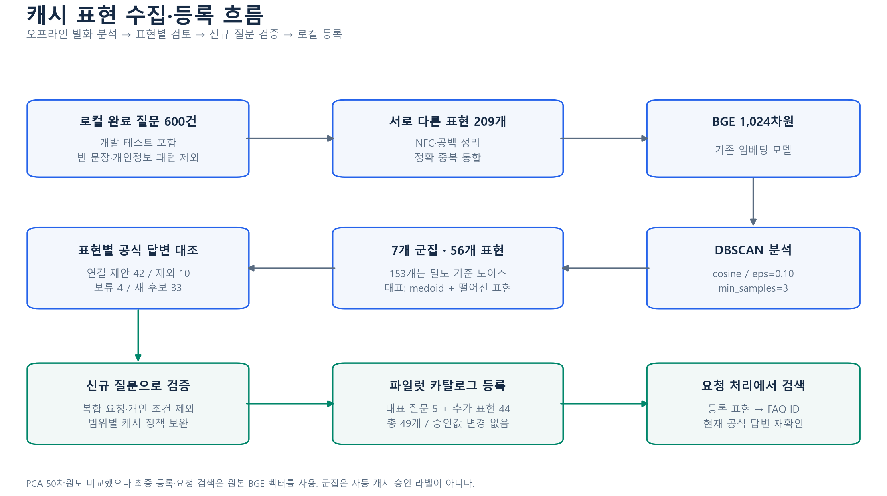
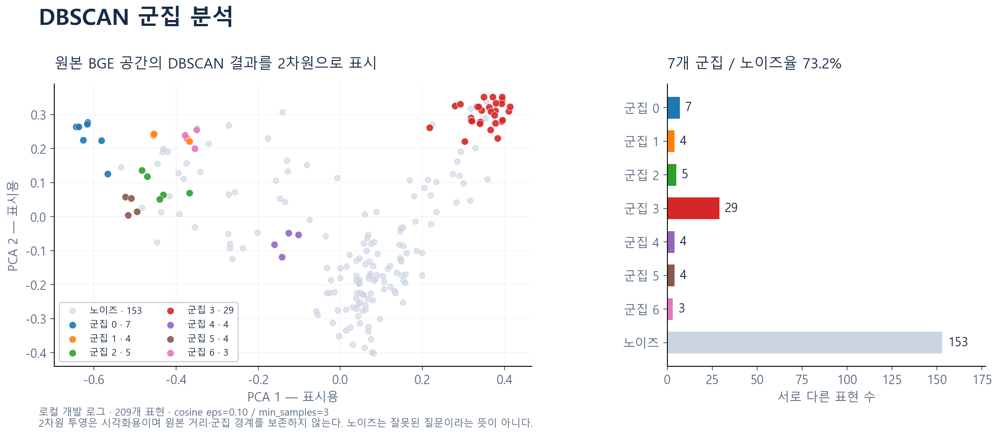
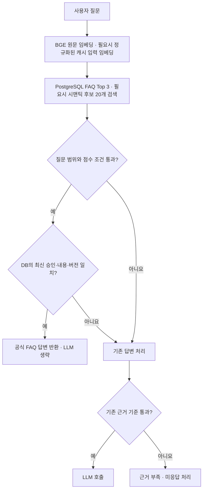
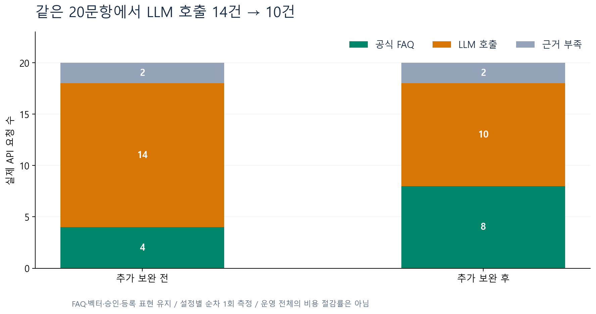
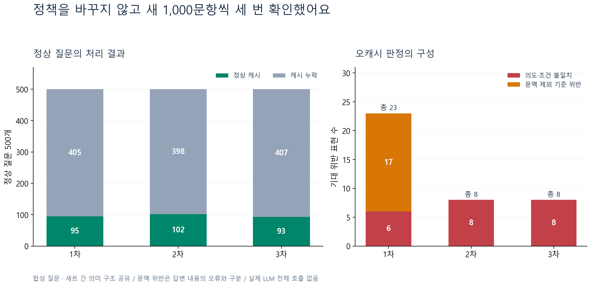

# 같은 질문인데 왜 매번 LLM을 호출할까요? — UBot의 시맨틱 캐시 실험

> 기록 시점 안내: 아래 FAQ별 범위·임계값과 측정 결과는 5개 FAQ 전용 검토 정책을 사용한 과거 실험이다. 현재 구현에서는 고정 ID 정책을 제거하고, 관리자 승인·유효한 표현 등록·공통 유사도와 경쟁 점수 차이로 판정한다. 새 FAQ 등록에 코드 수정이 필요하지 않으며, 과거 감소율을 현재 구성의 성과로 사용하지 않는다.

UBot은 통신 서비스에 관한 질문에 답하는 AI 상담 챗봇이에요. 사용자가 질문하면 관련 FAQ를 검색하고, 그 내용을 바탕으로 LLM이 답변을 만들어 줘요.

챗봇을 테스트하다가 조금 아쉬운 상황을 발견했어요. `esim이 뭔가요`처럼 FAQ에 이미 답이 있는 질문도 LLM으로 넘어가는 경우가 있었거든요. 표현을 바꾸면 어떤 질문은 공식 답변이 바로 나오고, 어떤 질문은 LLM을 기다려야 했어요.

같은 내용을 묻는 질문이라면 이미 준비된 답변을 사용할 수 있지 않을까요? 그렇게 하면 LLM 호출도 줄이고, 사용자가 기다리는 시간도 줄일 수 있을 것 같았어요.

이 생각에서 시작해 질문 표현을 모으고, 시맨틱 캐시를 붙이고, 질문 수를 늘려 가며 확인해 봤어요. 작은 테스트에서는 호출이 줄어드는 모습을 볼 수 있었지만, 더 많은 표현을 넣자 처음에는 보이지 않던 문제도 드러났어요. 이번 글에서는 그 과정을 순서대로 정리해 보려고 해요.

## 1. 같은 FAQ인데 검색 점수가 다른 것

처음 확인한 질문은 eSIM의 뜻을 묻는 표현들이었어요.

```text
esim이 뭔가요
esim이 뭐야?
esim이 어떤 건지 설명해줘.
아니 이심이 뭐야
```

FAQ에는 `eSIM이 무엇인가요?`라는 질문과 다음 답변이 있었어요.

> 물리적인 SIM 카드 없이 사용하는 디지털 SIM입니다.

그런데 검색 점수는 표현마다 꽤 달랐어요.

| 질문 | 1위 FAQ | BGE 코사인 유사도 |
|---|---|---:|
| esim이 뭔가요 | eSIM이 무엇인가요? | 0.763330 |
| esim이 어떤 건지 설명해줘. | eSIM이 무엇인가요? | 0.744864 |
| 아니 이심이 뭐야 | eSIM이 무엇인가요? | 0.519578 |

세 질문 모두 같은 FAQ를 1위로 찾았어요. 하지만 사람이 보기에는 비슷한 질문인데도, 기준 점수를 통과하는지는 달라졌어요. 코사인 유사도가 질문의 정답 확률을 의미하는 것은 아니기 때문에, 점수만 보고 같은 답변을 줘도 되는지 판단하기는 어려웠어요.

기존 답변 흐름은 다음과 같았어요.

```text
사용자 질문 → BGE 임베딩 → FAQ Top 3 검색 → 근거 기준 확인 → LLM 답변
```

여기서 FAQ의 공식 답변으로 충분한 질문은 LLM을 생략할 수 있게 만들고 싶었어요. 다만 eSIM이라는 단어가 들어갔다고 전부 같은 질문은 아니에요. `eSIM이 뭐야?`와 `eSIM을 어디서 발급받아?`는 필요한 답변이 다르니까요.

그래서 캐시로 처리되는 질문을 늘리는 과정에서, 다른 질문에 같은 답변을 보내는 경우도 함께 살펴보기로 했어요.

## 2. 한 FAQ에 여러 질문 표현을 연결하는 방식

방향을 잡는 데 [당근의 시맨틱 캐싱 도입 기록](https://medium.com/daangn/%EC%97%B0%EA%B0%84-llm-%ED%98%B8%EC%B6%9C-%EB%B9%84%EC%9A%A9-25-%EC%A0%88%EA%B0%90-%EC%9D%B8%ED%84%B4%EC%9D%B4-%EB%8F%84%EC%A0%84%ED%95%9C-%EC%8B%9C%EB%A7%A8%ED%8B%B1-%EC%BA%90%EC%8B%B1-%EB%8F%84%EC%9E%85-%EA%B8%B0%EB%A1%9D-af3de9a74d0c)이 도움이 됐어요. 채팅 발화를 분석해서 대표 문장을 모으고, 적절한 응답을 연결해 두는 접근을 참고했어요.

UBot에서는 공식 FAQ 하나에 여러 질문 표현을 연결했어요. 예를 들어 `esim이 뭐야?`와 `esim이 어떤 건지 설명해줘.`를 eSIM 정의 FAQ에 연결하는 거예요. 사용자의 새 질문이 이 표현들과 충분히 가깝고, 해당 FAQ의 답변 범위에 들어오면 현재 공식 답변을 반환하도록 했어요.

처음에는 답변 범위를 살펴보기 쉬운 다섯 FAQ로 시작했어요.

| FAQ | 답변 내용 |
|---|---|
| 3 | 번호이동 시 기존 전화번호 유지 |
| 6 | 기기만 변경할 때 전화번호 유지 |
| 11 | 유심만 교체할 때 전화번호 유지 |
| 14 | eSIM의 정의 |
| 16 | 실물 유심과 eSIM의 동시 사용 조건 |

이 글에서 다루는 요청 흐름은 기존 BGE 검색에 FAQ별 조건을 붙인 구성이에요. 시맨틱 캐시를 위해 추가 추론 서버를 띄우지는 않았어요.

## 3. 질문 이력에서 비슷한 표현을 모으는 것

여러 표현을 등록하려면 먼저 어떤 질문이 들어오는지 살펴봐야 했어요. 떠오르는 예시를 계속 추가하는 데서 더 나아가, 로컬에 저장된 질문 이력을 분석해 보기로 했어요.

완료된 질문 600건에서 최초 시도만 가져왔어요. 재시도와 재검색이 같은 요청을 반복해서 세는 것을 줄이기 위해서였어요. 이 데이터에는 개발 중에 보냈던 테스트 질문도 섞여 있어요.

공백과 NFC 정규화를 적용하고, 인사만 있는 문장 1건과 주소 패턴이 발견된 문장 2건을 제외했어요. 같은 표현은 하나로 합쳤고, 부정 표현이나 추가 요청은 그대로 남겼어요. 개인정보 패턴은 정규식으로 찾았기 때문에 탐지 범위에는 한계가 있어요.

이렇게 정리한 597건에서 서로 다른 표현 209개가 남았어요.



### DBSCAN으로 표현 묶어 보기

209개 표현을 BGE-m3의 1,024차원 벡터로 변환하고, DBSCAN으로 묶어 봤어요. DBSCAN은 가까운 점들이 밀집한 영역을 군집으로 만들고, 군집에 속하지 않는 점은 노이즈로 분류해요. 군집 수를 미리 지정하지 않고 질문 묶음을 살펴볼 수 있어서 사용했어요. [DBSCAN 공식 문서](https://scikit-learn.org/stable/modules/generated/sklearn.cluster.DBSCAN.html)

원본 벡터와 PCA로 50차원까지 줄인 벡터를 함께 확인했어요. 아래는 cosine distance, `eps=0.10`, `min_samples=3`일 때의 결과예요.

| 설정 | 군집 수 | 군집에 속한 표현 | 노이즈 표현 |
|---|---:|---:|---:|
| BGE 원본 1,024차원 | 7 | 56 | 153 |
| PCA 50차원 | 10 | 50 | 159 |

PCA 50차원의 설명 분산 비율은 약 86.4%였어요. 벡터 분산에 관한 수치라, 질문 의미를 86.4% 보존했다는 뜻으로 해석하지는 않았어요. 차원을 줄이면 거리도 달라지므로 같은 `eps`에서 군집이 더 많이 나온 것만으로 성능이 좋아졌다고 보기도 어려웠어요. 실제 검색에는 원본 BGE 벡터를 사용했어요. [PCA 공식 문서](https://scikit-learn.org/stable/modules/generated/sklearn.decomposition.PCA.html)



이 그림은 원본 공간에서 구한 군집 라벨을 PCA 2차원 좌표에 표시한 거예요. 그림의 점 간 거리를 검색 유사도로 그대로 읽을 수는 없어요. 노이즈로 나온 표현도 이 설정에서 군집에 속하지 않았다는 의미예요.

군집에 묶인 56개 표현은 하나씩 읽고 답변 범위를 확인했어요. 문장이 비슷해도 요청하는 내용이 다르면 같은 공식 답변을 줄 수 없었거든요. FAQ 연결 제안 42개, 제외 10개, 보류 4개로 나눴고, 기존 표현과 대표 질문을 빼고 새 후보 33개를 얻었어요.

이후 검토와 테스트를 거쳐 대표 질문 5개와 추가 표현 44개, 총 49개를 로컬에 등록했어요. DBSCAN은 이처럼 표현 후보를 찾는 분석 과정에서 사용했어요. 사용자 요청이 들어올 때마다 군집화를 다시 수행하는 구조는 아니에요.

## 4. 비슷한 문장에 다른 요청이 섞이는 것

표현을 늘리고 점수 기준을 낮추니 캐시로 처리되는 질문은 늘었어요. 그런데 다음 질문도 공식 답변 하나로 끝나는 경우가 있었어요.

```text
실물 유심과 이심을 동시에 사용할 수 있는지 궁금해요.
지원 단말 목록도 부탁드립니다.
```

FAQ에는 듀얼 SIM 지원 단말기에서 함께 사용할 수 있다는 답변이 있어요. 하지만 지원 단말 목록은 없어요. 동시 사용 가능 여부만 답하면 사용자가 함께 요청한 목록은 빠지게 되는 거죠.

`제가 쓰는 단말에서 이심과 유심을 같이 사용할 수 있나요?`라는 질문도 살펴봤어요. 이 경우에는 어떤 단말을 쓰는지 알아야 구체적인 답변을 할 수 있어요.

이런 사례를 확인하면서 FAQ마다 주제, 조건, 요청과 제외할 표현을 정했어요. 개인 조회, 비용, 절차, 추가 요청, 앞선 대화 참조를 걸러 보고, 검토한 어휘로 구성된 질문인지도 확인했어요. 임베딩에는 질문 원문을 그대로 사용하고, 이 검사는 따로 수행했어요.

점수와 경쟁 FAQ와의 차이도 함께 확인했어요. 같은 FAQ에 연결된 여러 표현은 최고 점수 하나로 묶었어요. 같은 답변에 연결된 두 표현 때문에 점수 차이가 좁아지는 것을 피하기 위해서예요.

| FAQ | 최소 코사인 유사도 | 경쟁 FAQ와 최소 차이 |
|---|---:|---:|
| 3 | 0.83 | 0.03 |
| 6 | 0.85 | 0.03 |
| 11 | 0.83 | 0.04 |
| 14 | 0.75 | 0.04 |
| 16 | 0.80 | 0.04 |

이 값들은 현재 BGE와 개발용 질문을 바탕으로 정한 실험 기준이에요. 번호이동과 기기만 교체하는 경우처럼 범위가 명확히 다른 검토 FAQ는 경쟁에서 제외했어요. 그 FAQ의 질문이나 답변이 변경되면 해당 제외 처리를 적용하지 않아요. 나머지 FAQ는 캐시 승인 여부와 관계없이 경쟁 점수 계산에 남겼어요.

## 5. 질문을 받은 뒤 공식 답변을 반환하는 과정

기존 BGE와 PostgreSQL을 이용해 Java BE의 답변 흐름에 연결했어요. PR 리뷰를 반영한 현재 구조는 다음과 같아요.



기존 답변 처리는 공식 답변을 반환하지 못했을 때 진행해요. 현재 캐시 검색·등록에는 공백과 반복 문장부호를 정리한 입력을 사용해요. 예를 들어 `esim이 뭐야?`와 `esim이 뭐야??`를 같은 키로 등록해요. 조건이나 부정 표현, 두 질문 사이의 문장 경계는 지우지 않아요.

1. 질문 원문을 BGE에 보내 임베딩을 만들어요.
2. 기존 답변에 사용할 FAQ Top 3를 검색해요.
3. 검토한 캐시 범위에 들어오는 질문은 FAQ별로 묶은 후보 20개도 검색해요.
4. 범위 조건, FAQ별 점수와 경쟁 점수 차이를 확인해요.
5. 현재 FAQ의 승인·내용·버전을 검증한 뒤 공식 답변을 반환해요.

원문과 정규화된 캐시 입력이 같으면 한 번 만든 임베딩을 함께 사용해요. 달라지면 기존 FAQ 검색은 원문 그대로 두고, 캐시용 임베딩을 추가로 만들어요. 기존 LLM 경로의 검색 결과와 프롬프트를 유지하기 위한 선택이에요. 이 경우의 추가 호출 시간은 이전 실험 수치에 포함되지 않았어요.

답변을 반환하기 전에는 현재 DB에서 FAQ가 활성 상태이고 `cacheable=true`, `GENERAL` 의도를 유지하는지 확인해요. 등록 표현에 연결된 공식 질문·답변·버전과 정책에서 검토한 답변도 현재 내용과 일치해야 해요.

초기 실험에서는 Redis에도 공식 답변을 저장했어요. 그런데 답변을 반환하기 전에 항상 DB에서 최신 내용을 확인하므로, Redis를 거쳐도 DB 조회가 줄어들지는 않았어요. PR 리뷰에서 이 부분을 짚어 주셔서 FAQ 답변의 Redis 저장·조회를 제거했어요. 지금은 검증된 DB 답변을 바로 반환하고, 이 경로를 `FAQ_OFFICIAL`로 기록해요. 기존 Redis 키는 사용하지 않고 TTL에 따라 만료돼요.

아래 응답 시간과 호출 수는 Redis를 사용하던 이전 실험에서 측정한 값이에요. Redis 제거 후 성능을 다시 측정한 결과는 아니에요.

캐시 조건을 통과하지 못하면 기존 FAQ 검색 결과로 넘어가요. Top 3에서 유사도 0.75 이상인 근거를 LLM에 전달하고, 기준을 통과한 근거가 없으면 `CHAT-013`으로 근거 부족을 안내해요. 관리자 승인이나 답변이 바뀐 경우에도 직접 반환을 중단하도록 했어요.

## 6. 작은 테스트에서 줄어든 LLM 호출

먼저 같은 20문항을 실제 API에 보내 비교했어요. 캐시로 처리할 질문 10개와 제외할 질문 10개를 구성하고, 요청마다 새 게스트 세션을 사용했어요. BGE와 Qwen을 워밍업한 뒤 측정했고, 워밍업 요청은 결과에서 뺐어요. LLM은 로컬 Ollama의 `qwen3:4b-instruct`를 비추론 모드로 사용했어요.

단계별 처리 경로는 다음과 같았어요.

| 처리 경로 | 처음의 엄격 설정 | 표현·범위 보완 | 어미·제외 조건 추가 보완 |
|---|---:|---:|---:|
| 공식 FAQ 직접 답변 | 1 | 4 | 8 |
| 실제 LLM 호출 | 17 | 14 | 10 |
| 근거 부족 | 2 | 2 | 2 |
| 오캐시 | 0 | 0 | 0 |

처음에는 17건이었던 LLM 호출이 14건으로 줄었어요. 여기서 기록한 호출 감소율이 17.6%였어요. 이후 어미와 제외 조건을 더 보완하자 같은 20문항에서 10건으로 줄었고요. 처음의 17건을 기준으로 계산하면 41.2%예요.

```text
첫 보완: (17 - 14) / 17 × 100 ≈ 17.6%
추가 보완 후: (17 - 10) / 17 × 100 ≈ 41.2%
```

처음의 엄격 설정에도 시맨틱 캐시는 있었어요. 그때는 등록 표현 14개와 0.95/0.15 기준을 사용했어요. 이후에는 표현 49개와 FAQ별 조건을 적용했어요. 따라서 캐시가 없는 develop 원본과 비교한 수치는 아니에요.

마지막 보완에서는 표현 49개, FAQ 본문·벡터·승인을 유지한 채 조건을 바꾸고, 보완 전과 후를 다시 측정했어요. 위 표의 첫 설정은 이전에 기록한 측정값이에요.



20문항에서는 오캐시가 없었고, 공식 답변이 늘어난 만큼 LLM 호출이 줄었어요. 이 결과를 보고 다른 표현에서도 같은 모습을 볼 수 있을지 더 확인해 보기로 했어요.

## 7. LLM을 생략한 질문의 응답 시간

호출 횟수와 함께 전체 HTTP 응답이 돌아올 때까지의 시간도 기록했어요. 마지막 보완 전후의 20문항 평균은 1,018.3ms에서 780.5ms로 줄었어요. 보완 후 공식 답변 8건의 중앙값은 142.7ms였어요.

새로 공식 답변으로 처리된 네 질문은 다음과 같았어요.

| 질문 | 보완 전 | 보완 후 |
|---|---:|---:|
| 기기 변경만 하는데 휴대전화 번호는 그대로 남을까요? | 854.7ms | 107.2ms |
| 유심을 교체해도 지금 쓰는 전화번호가 동일하게 유지됩니까? | 875.8ms | 98.4ms |
| eSIM 개념을 짧게 풀어서 설명해주시겠어요? | 863.4ms | 183.0ms |
| eSIM을 사용하면서 일반 유심을 함께 써도 됩니까? | 2,080.8ms | 133.4ms |

이 질문들에서는 LLM 대신 공식 답변을 전달하면서 기다리는 시간이 짧아졌어요. 다만 설정별로 순서대로 한 번씩 측정한 값이에요. 답변 길이나 서버 상태에 따라 시간이 달라질 수 있으므로, 운영의 평균·p95·p99를 확인하려면 더 많은 요청과 반복 측정이 필요해요.

## 8. 질문을 늘리자 보이기 시작한 문제

20문항에서는 괜찮아 보였지만, 이것만으로 적용 범위를 넓히기에는 확인한 표현이 적었어요. 그래서 같은 의미의 질문뿐 아니라 조건이 다른 질문도 더 넣었어요.

처음 만든 1,000문항에서는 정상 캐시 246건, 오캐시 판정 17건, 누락 254건이 나왔어요. 이 중 기존 BGE 근거 기준에서 LLM으로 넘길 수 있는 질문은 767개였고, 정상 캐시로 생략 가능한 질문은 217개였어요. 여기서 계산한 값이 28.3%예요.

이 28.3%는 BGE 검색과 Java 판정으로 계산한 예상 호출 감소율이에요. 앞의 41.2%는 선택한 20문항에서 실제 LLM 호출 수를 센 값이고요. 질문과 비교 기준이 달라서 두 수치를 이어 붙여 성능 변화로 보지는 않았어요.

이어서 새 1,000문항 세 세트를 만들었어요. 질문과 기대 답을 모두 먼저 확정하고, 세 세트에서는 정책과 설정을 바꾸지 않았어요.

세트마다 FAQ 답변으로 해결할 정상 질문 500개, 관련된 다른 의도 200개, 복합 질문·개인 조회·문맥 참조 각 100개를 넣었어요. 정상 질문은 검토한 다섯 FAQ에 각각 100개씩 배분했어요.

| 세트 | 정상 캐시 | 오캐시 판정 | 캐시 누락 | 정상 호출 감소 예상 |
|---|---:|---:|---:|---:|
| 1차 | 95 | 23 | 405 | 10.0% |
| 2차 | 102 | 8 | 398 | 13.4% |
| 3차 | 93 | 8 | 407 | 11.0% |
| 합계 | 290 | 39 | 1,210 | 11.4% |

합산 예상 감소율은 기존 BGE Top 3 / 0.75 기준에서 LLM 근거가 있는 2,218개 중 정상 캐시 253개를 기준으로 계산했어요. 오캐시로 생략되는 요청은 성과에서 뺐어요. 전체 3,000개에 LLM 답변을 생성한 실험은 아니에요.



세 세트는 핵심 문장 750개를 네 가지 말투로 바꾼 자료예요. 의미 구조로 묶으면 150개 문장군을 공유해요. 기존 문항과 정확히 겹치는 표현은 없었지만, 서로 독립적인 실제 사용자 발화 3,000개를 확인한 것으로 보지는 않았어요. 라벨도 공식 답변의 범위를 기준으로 작성한 실험용 기대값이에요.

### 같은 단어를 써도 조건이 달라지는 질문

오캐시 판정 39건은 다음 유형에서 나왔어요.

| 유형 | 건수 |
|---|---:|
| 새 번호 요청·기존 번호를 가져가지 않는 가입 | 7 |
| 번호이동을 하지 않는다는 조건 | 15 |
| 문맥 참조를 제외하기로 한 기준 위반 | 17 |

예를 들어 아래 질문이 FAQ 3을 선택했어요.

> 번호이동 없이 통신사를 옮겨도 같은 전화번호를 쓸 수 있는지 설명 부탁드립니다.

선택한 공식 답변은 다음과 같았어요.

> 네. 번호이동 시 기존 전화번호를 그대로 유지할 수 있습니다.

주제는 가까워요. 하지만 사용자는 ‘번호이동 없이’라는 조건을 붙였어요. 선택한 답변은 번호이동을 전제로 하고 있어서 이 조건에 답하지 못했어요. 이런 질문이 세 세트 모두에서 통과했어요.

문맥 참조 17건은 따로 봤어요. 앞선 대화가 필요한 질문을 보수적으로 제외하기로 했는데 그 기준을 통과한 경우예요. 이 17건을 모두 답변 내용이 틀린 사례로 해석하지는 않았어요.

의심 질문 3개와 정상 캐시 4개는 실제 API에도 보내 봤어요. 일곱 질문 모두 Java 판정과 같은 공식 FAQ 경로였어요. 의도·조건이 다른 질문 두 개가 실제 서버에서도 공식 답변으로 반환되는 것을 확인했어요.

### 조건을 좁혔는데도 남은 오류와 누락

캐시에서 빠지는 질문도 많았어요. 누락 1,210개 중 1,015개가 어휘·범위 조건에서 제외됐어요. 점수 기준을 통과하지 못한 경우는 138개였고요.

같은 핵심 문장을 말투만 바꿔도 일부 표현만 캐시되고 나머지는 빠지는 경우가 있었어요. 조건을 좁히는 과정에서 정상 표현을 받아들이는 범위도 좁아졌지만, 새 번호 요청과 부정 조건의 오류는 남아 있었던 거예요.

이번 세 세트에서는 결과를 보고 코드를 수정하지 않았어요. 이전 1,000문항도 저장된 벡터와 후보로 다시 판정했는데, 오캐시 17건을 포함해 결과가 그대로였어요. 세트마다 숫자가 달라진 것은 질문 구성의 차이로 봤어요.

## 9. 이번 실험을 마치며

처음 목표는 FAQ에 이미 있는 답을 더 빨리 전달하는 것이었어요. 여러 질문 표현을 공식 FAQ에 연결하니, 선택한 20문항에서 LLM 호출과 응답 시간이 줄어드는 모습을 확인할 수 있었어요. DBSCAN으로 질문 이력을 살펴보고, 기존 BGE·PostgreSQL·Redis에 캐시 경로를 연결하는 과정도 진행했어요.

질문을 더 넣으면서는 다른 점이 보였어요. ‘비슷한 질문을 찾았는가’와 ‘이 답변을 그대로 줘도 되는가’를 각각 확인해야 했어요. 특히 기존 번호 유지와 새 번호 선택, 번호이동과 번호이동을 하지 않는 조건은 비슷한 단어를 쓰지만 필요한 답이 달랐어요.

지금은 다섯 FAQ를 대상으로 로컬에서 검증한 상태예요. 작은 테스트의 41.2%를 운영 전체의 호출 감소나 비용 절감 성과로 발표할 단계는 아니에요. 넓힌 문항에서는 오류와 누락이 함께 확인됐기 때문이에요.

다음에는 반복해서 드러난 조건을 먼저 검토하고, 수정에 사용한 질문은 회귀 검사로 남기려고 해요. 이후에는 수정에 쓰지 않은 새 표현과 실제 사용자 질문으로 확인해야 해요. FAQ 답변의 범위와 기대 라벨도 팀에서 함께 검수할 필요가 있어요.

이번에는 어느 표현에서 직접 답변이 가능했고, 어떤 조건에서 기존 답변 흐름으로 넘겨야 하는지 기록을 남겼어요. 다음 검증에서도 이 기록을 기준으로, 호출 수와 답변의 적절함을 함께 확인해 보려고 해요.

---

### 관련 문서

- [백엔드 실행과 표현 등록 방법](../how-to/103-faq-semantic-cache.md)

이번 글의 측정값은 이전 실험 환경에서 얻은 결과예요. 최신 develop을 반영한 현재 브랜치에서 다시 측정한 결과는 아니에요.

그림은 저장된 실험 결과로 만들었어요. 이미지 폴더의 `source-manifest.json`에는 원본 경로와 해시를 남겼어요. 전체 질문 목록과 상세 실험 자료는 로컬에 따로 보관하고 있어요.
